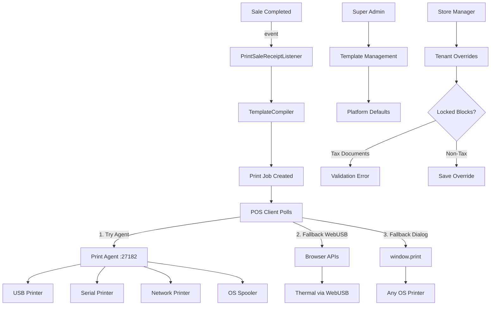
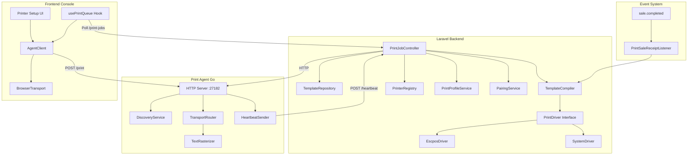
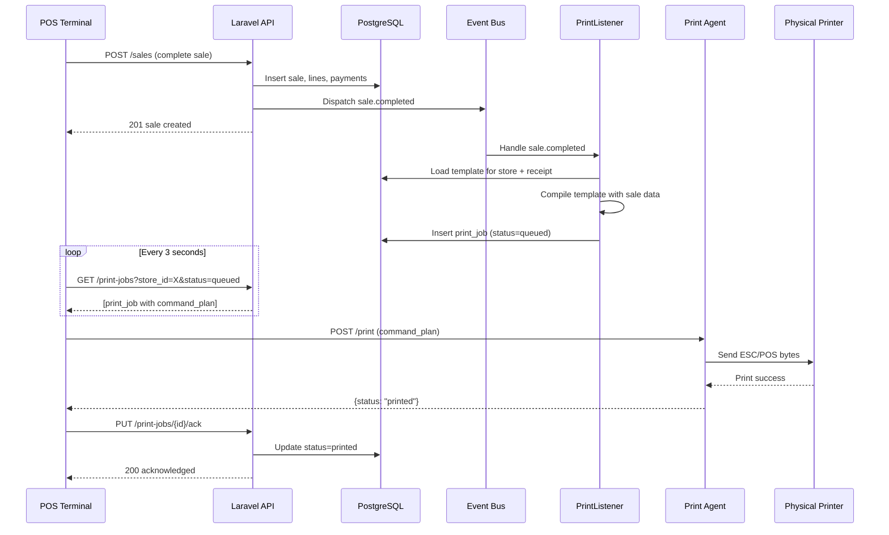
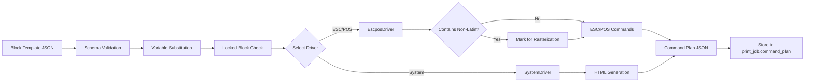

# Design Document: Printing System

## Overview

The Printing module provides comprehensive receipt and document printing capabilities for the SelfX Retail system. The architecture is built on three core principles:

1. **Security Boundary**: Laravel never connects to printer hardware. All physical I/O is handled by the Print Agent (local binary) or browser APIs.
2. **Event-Driven Integration**: The Printing module has no compile-time dependency on POS or Orders modules. Integration occurs through domain events.
3. **Progressive Degradation**: Three-transport fallback chain (agent → browser_raw → browser_dialog) ensures printing works across environments.

### System Context



### Key Design Decisions

| Decision | Rationale |
|----------|-----------|
| Block-based templates instead of HTML | Prevents XSS, enables ESC/POS compilation, supports non-Latin rasterization |
| Command plan JSON as intermediate format | Decouples compilation from execution, enables multi-transport support |
| Event-driven integration | Eliminates module dependencies, allows async processing |
| Three-transport fallback | Maximizes printer compatibility without requiring complex setup |
| Print Agent in Go | Single binary distribution, no runtime dependencies, cross-platform |
| Pairing security with device tokens | Prevents unauthorized print jobs from malicious origins |

## Architecture

### Component Architecture



### Data Flow: Receipt Printing



### Template Compilation Pipeline



## Components and Interfaces

### PrintDriver Interface

```php
<?php

namespace App\Modules\Printing\Contracts;

use App\Modules\Printing\Data\BlockTemplate;
use App\Modules\Printing\Data\CommandPlan;
use App\Modules\Printing\Enums\PrinterType;

interface PrintDriver
{
    /**
     * Compile a block template into a command plan.
     *
     * @param BlockTemplate $template The template to compile
     * @param array<string, mixed> $context Variable substitution context
     * @return CommandPlan The compiled command plan
     * @throws \App\Modules\Printing\Exceptions\TemplateCompilationException
     */
    public function compile(BlockTemplate $template, array $context): CommandPlan;
    
    /**
     * Check if this driver supports the given printer type.
     *
     * @param PrinterType $type The printer type to check
     * @return bool True if supported
     */
    public function supports(PrinterType $type): bool;
    
    /**
     * Get the driver name.
     *
     * @return string Driver identifier (escpos, system, epson_epos, star_webprnt, sdk)
     */
    public function getName(): string;
    
    /**
     * Validate that the template is compatible with this driver.
     *
     * @param BlockTemplate $template The template to validate
     * @return array<string> List of validation errors (empty if valid)
     */
    public function validateTemplate(BlockTemplate $template): array;
}
```

### EscposDriver Implementation

```php
<?php

namespace App\Modules\Printing\Drivers;

use App\Modules\Printing\Contracts\PrintDriver;
use App\Modules\Printing\Data\BlockTemplate;
use App\Modules\Printing\Data\CommandPlan;
use App\Modules\Printing\Enums\PrinterType;
use App\Modules\Printing\Exceptions\TemplateCompilationException;
use Mike42\Escpos\PrintConnector\DummyPrintConnector;
use Mike42\Escpos\Printer as EscposPrinter;

class EscposDriver implements PrintDriver
{
    public function compile(BlockTemplate $template, array $context): CommandPlan
    {
        $connector = new DummyPrintConnector();
        $printer = new EscposPrinter($connector);
        
        try {
            foreach ($template->blocks as $block) {
                $this->compileBlock($block, $printer, $context);
            }
            
            $printer->close();
            
            // Get raw bytes from dummy connector
            $bytes = $connector->getData();
            
            // Detect non-Latin text for rasterization hint
            $requiresRasterization = $this->detectNonLatinText($template, $context);
            
            return new CommandPlan(
                format: 'escpos',
                data: base64_encode($bytes),
                metadata: [
                    'paper_width_mm' => $template->paperWidth ?? 80,
                    'requires_rasterization' => $requiresRasterization,
                    'raster_locales' => $this->extractNonLatinLocales($template, $context),
                ]
            );
        } catch (\Exception $e) {
            throw new TemplateCompilationException(
                "ESC/POS compilation failed: " . $e->getMessage(),
                previous: $e
            );
        }
    }
    
    private function compileBlock(object $block, EscposPrinter $printer, array $context): void
    {
        match ($block->type) {
            'text' => $this->compileText($block, $printer, $context),
            'spacer' => $this->compileSpacer($block, $printer),
            'rule' => $this->compileRule($block, $printer),
            'columns' => $this->compileColumns($block, $printer, $context),
            'image' => $this->compileImage($block, $printer, $context),
            'barcode' => $this->compileBarcode($block, $printer, $context),
            'qr' => $this->compileQr($block, $printer, $context),
            'feed' => $this->compileFeed($block, $printer),
            'cut' => $this->compileCut($block, $printer),
            'drawer' => $this->compileDrawer($block, $printer),
            default => throw new \InvalidArgumentException("Unknown block type: {$block->type}")
        };
    }
    
    private function compileText(object $block, EscposPrinter $printer, array $context): void
    {
        // Set alignment
        $align = match ($block->align ?? 'left') {
            'left' => EscposPrinter::ALIGN_LEFT,
            'center' => EscposPrinter::ALIGN_CENTER,
            'right' => EscposPrinter::ALIGN_RIGHT,
            default => EscposPrinter::ALIGN_LEFT,
        };
        $printer->setJustification($align);
        
        // Set emphasis (bold)
        $bold = ($block->weight ?? 'regular') === 'bold';
        $printer->setEmphasis($bold);
        
        // Set text size (ESC/POS supports 1-8 for width and height)
        $size = match ($block->size ?? 'md') {
            'sm' => [1, 1],
            'md' => [2, 2],
            'lg' => [3, 3],
            default => [2, 2],
        };
        $printer->setTextSize($size[0], $size[1]);
        
        // Substitute variables
        $text = $this->substituteVariables($block->content ?? '', $context);
        
        // Apply uppercase if specified
        if ($block->uppercase ?? false) {
            $text = mb_strtoupper($text, 'UTF-8');
        }
        
        // Print text
        $printer->text($text . "\n");
        
        // Reset formatting
        $printer->setEmphasis(false);
        $printer->setTextSize(1, 1);
        $printer->setJustification(EscposPrinter::ALIGN_LEFT);
    }
    
    private function compileSpacer(object $block, EscposPrinter $printer): void
    {
        $lines = max(0, min(8, $block->lines ?? 1));
        for ($i = 0; $i < $lines; $i++) {
            $printer->feed();
        }
    }
    
    private function compileRule(object $block, EscposPrinter $printer): void
    {
        $char = $block->char ?? '-';
        $width = $block->width ?? 48; // Default 80mm paper ~48 chars
        $printer->text(str_repeat($char, $width) . "\n");
    }
    
    private function compileColumns(object $block, EscposPrinter $printer, array $context): void
    {
        $columns = $block->columns ?? [];
        if (empty($columns)) {
            return;
        }
        
        // Calculate column widths
        $totalWidth = 48; // Default for 80mm paper
        $colCount = count($columns);
        $colWidth = (int) floor($totalWidth / $colCount);
        
        $line = '';
        foreach ($columns as $col) {
            $text = $this->substituteVariables($col->content ?? '', $context);
            $align = $col->align ?? 'left';
            
            $text = match ($align) {
                'left' => str_pad($text, $colWidth, ' ', STR_PAD_RIGHT),
                'center' => str_pad($text, $colWidth, ' ', STR_PAD_BOTH),
                'right' => str_pad($text, $colWidth, ' ', STR_PAD_LEFT),
                default => str_pad($text, $colWidth, ' ', STR_PAD_RIGHT),
            };
            
            $line .= mb_substr($text, 0, $colWidth);
        }
        
        $printer->text($line . "\n");
    }
    
    private function compileBarcode(object $block, EscposPrinter $printer, array $context): void
    {
        $data = $this->substituteVariables($block->data ?? '', $context);
        $type = $block->barcodeType ?? 'CODE128';
        
        // Map barcode type to ESC/POS constant
        $escposType = match ($type) {
            'CODE128' => EscposPrinter::BARCODE_CODE128,
            'EAN13' => EscposPrinter::BARCODE_EAN13,
            'CODE39' => EscposPrinter::BARCODE_CODE39,
            'UPCA' => EscposPrinter::BARCODE_UPCA,
            default => EscposPrinter::BARCODE_CODE128,
        };
        
        $height = $block->height ?? 50;
        $printer->setBarcodeHeight($height);
        $printer->barcode($data, $escposType);
    }
    
    private function compileQr(object $block, EscposPrinter $printer, array $context): void
    {
        $data = $this->substituteVariables($block->data ?? '', $context);
        $size = $block->size ?? 6; // Module size 1-16
        $errorCorrection = match ($block->errorCorrection ?? 'M') {
            'L' => EscposPrinter::QR_ECLEVEL_L,
            'M' => EscposPrinter::QR_ECLEVEL_M,
            'Q' => EscposPrinter::QR_ECLEVEL_Q,
            'H' => EscposPrinter::QR_ECLEVEL_H,
            default => EscposPrinter::QR_ECLEVEL_M,
        };
        
        $printer->qrCode($data, $errorCorrection, $size);
    }
    
    private function compileFeed(object $block, EscposPrinter $printer): void
    {
        $lines = max(0, min(8, $block->lines ?? 1));
        for ($i = 0; $i < $lines; $i++) {
            $printer->feed();
        }
    }
    
    private function compileCut(object $block, EscposPrinter $printer): void
    {
        $mode = match ($block->mode ?? 'partial') {
            'full' => EscposPrinter::CUT_FULL,
            'partial' => EscposPrinter::CUT_PARTIAL,
            'none' => null,
            default => EscposPrinter::CUT_PARTIAL,
        };
        
        if ($mode !== null) {
            $printer->cut($mode);
        }
    }
    
    private function compileDrawer(object $block, EscposPrinter $printer): void
    {
        $pin = ($block->pin ?? 0) === 1 ? EscposPrinter::DRAWER_1 : EscposPrinter::DRAWER_0;
        $pulseOn = $block->pulseOn ?? 120; // milliseconds
        $pulseOff = $block->pulseOff ?? 240;
        
        $printer->pulse($pin, $pulseOn, $pulseOff);
    }
    
    private function compileImage(object $block, EscposPrinter $printer, array $context): void
    {
        // Image handling - load from storage, convert to monochrome bitmap
        // This is a simplified placeholder
        $imagePath = $this->substituteVariables($block->src ?? '', $context);
        
        if (!$imagePath || !file_exists($imagePath)) {
            return;
        }
        
        try {
            $img = EscposImage::load($imagePath);
            $printer->bitImage($img);
        } catch (\Exception $e) {
            // Log error but don't fail the entire print job
            \Log::warning("Failed to print image: {$e->getMessage()}");
        }
    }
    
    private function substituteVariables(string $text, array $context): string
    {
        return preg_replace_callback('/\{\{(\w+)\}\}/', function ($matches) use ($context) {
            $key = $matches[1];
            return $context[$key] ?? '';
        }, $text);
    }
    
    private function detectNonLatinText(BlockTemplate $template, array $context): bool
    {
        // Check if any text blocks contain Telugu or Hindi characters after substitution
        foreach ($template->blocks as $block) {
            if ($block->type === 'text') {
                $text = $this->substituteVariables($block->content ?? '', $context);
                // Unicode ranges: Telugu (0C00-0C7F), Devanagari (0900-097F)
                if (preg_match('/[\x{0900}-\x{097F}\x{0C00}-\x{0C7F}]/u', $text)) {
                    return true;
                }
            }
        }
        return false;
    }
    
    private function extractNonLatinLocales(BlockTemplate $template, array $context): array
    {
        $locales = [];
        foreach ($template->blocks as $block) {
            if ($block->type === 'text') {
                $text = $this->substituteVariables($block->content ?? '', $context);
                if (preg_match('/[\x{0C00}-\x{0C7F}]/u', $text)) {
                    $locales[] = 'te'; // Telugu
                }
                if (preg_match('/[\x{0900}-\x{097F}]/u', $text)) {
                    $locales[] = 'hi'; // Hindi
                }
            }
        }
        return array_unique($locales);
    }
    
    public function supports(PrinterType $type): bool
    {
        return in_array($type, [
            PrinterType::THERMAL_58MM,
            PrinterType::THERMAL_80MM,
        ]);
    }
    
    public function getName(): string
    {
        return 'escpos';
    }
    
    public function validateTemplate(BlockTemplate $template): array
    {
        $errors = [];
        
        // Check for raw ESC/POS bytes
        foreach ($template->blocks as $block) {
            if (isset($block->content) && str_contains($block->content, "\x1b")) {
                $errors[] = "Block '{$block->type}' contains raw ESC/POS escape sequences";
            }
        }
        
        // Validate cut is only at the end
        $cutCount = 0;
        $cutIndex = -1;
        foreach ($template->blocks as $index => $block) {
            if ($block->type === 'cut') {
                $cutCount++;
                $cutIndex = $index;
            }
        }
        
        if ($cutCount > 1) {
            $errors[] = "Template contains multiple cut blocks (only one allowed at end)";
        }
        
        if ($cutIndex !== -1 && $cutIndex !== count($template->blocks) - 1) {
            $errors[] = "Cut block must be the last block in template";
        }
        
        return $errors;
    }
}
```

### TemplateCompiler

```php
<?php

namespace App\Modules\Printing\Services;

use App\Modules\Printing\Contracts\PrintDriver;
use App\Modules\Printing\Data\BlockTemplate;
use App\Modules\Printing\Data\CommandPlan;
use App\Modules\Printing\Enums\DocumentKind;
use App\Modules\Printing\Exceptions\TemplateCompilationException;
use App\Modules\Printing\Models\DocumentTemplate;

class TemplateCompiler
{
    public function __construct(
        private TemplateRepository $repository,
        private PrintDriverRegistry $driverRegistry,
    ) {}
    
    /**
     * Compile a template for the given document kind and context.
     *
     * @param string $tenantId Tenant ID (null for platform defaults)
     * @param DocumentKind $kind Document kind (receipt, label, etc.)
     * @param string $locale Locale (en, te, hi)
     * @param array<string, mixed> $context Variable substitution context
     * @param string $driverName Driver to use (escpos, system, etc.)
     * @return CommandPlan The compiled command plan
     */
    public function compile(
        ?string $tenantId,
        DocumentKind $kind,
        string $locale,
        array $context,
        string $driverName = 'escpos'
    ): CommandPlan {
        // Load template
        $template = $this->repository->getActiveTemplate($tenantId, $kind, $locale);
        
        if (!$template) {
            throw new TemplateCompilationException(
                "No template found for {$kind->value} in locale {$locale}"
            );
        }
        
        // Parse template blocks
        $blockTemplate = $this->parseTemplate($template);
        
        // Validate locked blocks if tenant override
        if ($tenantId && $template->tenant_id) {
            $this->validateLockedBlocks($blockTemplate, $kind);
        }
        
        // Get driver
        $driver = $this->driverRegistry->get($driverName);
        
        if (!$driver) {
            throw new TemplateCompilationException("Unknown driver: {$driverName}");
        }
        
        // Validate template compatibility with driver
        $errors = $driver->validateTemplate($blockTemplate);
        if (!empty($errors)) {
            throw new TemplateCompilationException(
                "Template validation failed: " . implode(', ', $errors)
            );
        }
        
        // Compile
        return $driver->compile($blockTemplate, $context);
    }
    
    /**
     * Preview a template with fixture data (no side effects).
     *
     * @param string|null $tenantId Tenant ID
     * @param DocumentKind $kind Document kind
     * @param string $locale Locale
     * @return array{html: string, warnings: array<string>} Preview HTML and warnings
     */
    public function preview(
        ?string $tenantId,
        DocumentKind $kind,
        string $locale
    ): array {
        $fixtureData = $this->repository->getFixtureData($kind);
        
        try {
            $plan = $this->compile($tenantId, $kind, $locale, $fixtureData, 'system');
            
            // Render HTML preview
            $html = $this->renderPreviewHtml($plan, $fixtureData);
            
            return [
                'html' => $html,
                'warnings' => [],
            ];
        } catch (TemplateCompilationException $e) {
            return [
                'html' => "<div class='error'>Compilation failed: {$e->getMessage()}</div>",
                'warnings' => [$e->getMessage()],
            ];
        }
    }
    
    private function parseTemplate(DocumentTemplate $template): BlockTemplate
    {
        $content = is_string($template->content)
            ? json_decode($template->content, false)
            : $template->content;
        
        return new BlockTemplate(
            blocks: $content->blocks ?? [],
            paperWidth: $content->paper_width_mm ?? 80,
            locale: $template->locale,
        );
    }
    
    private function validateLockedBlocks(BlockTemplate $template, DocumentKind $kind): void
    {
        // Tax documents have locked blocks that tenants cannot remove
        if (!in_array($kind, [DocumentKind::INVOICE_PDF, DocumentKind::RECEIPT])) {
            return;
        }
        
        $requiredBlocks = match ($kind) {
            DocumentKind::INVOICE_PDF, DocumentKind::RECEIPT => [
                'invoice_number',
                'gstin',
                'tax_table',
            ],
            default => [],
        };
        
        $foundBlocks = [];
        foreach ($template->blocks as $block) {
            if (isset($block->id) && in_array($block->id, $requiredBlocks)) {
                $foundBlocks[] = $block->id;
            }
        }
        
        $missing = array_diff($requiredBlocks, $foundBlocks);
        if (!empty($missing)) {
            throw new TemplateCompilationException(
                "Template missing required locked blocks: " . implode(', ', $missing)
            );
        }
    }
    
    private function renderPreviewHtml(CommandPlan $plan, array $context): string
    {
        // For system driver, the plan data is already HTML
        if ($plan->format === 'html') {
            return base64_decode($plan->data);
        }
        
        // For ESC/POS, render a visual representation
        return "<div class='escpos-preview'>
            <p class='text-muted'>ESC/POS preview not yet implemented</p>
            <p>Compiled {$plan->metadata['command_count'] ?? 0} commands</p>
            </div>";
    }
}
```

### PrintJobCreator

```php
<?php

namespace App\Modules\Printing\Actions;

use App\Modules\Printing\Data\CommandPlan;
use App\Modules\Printing\Enums\DocumentKind;
use App\Modules\Printing\Models\PrintJob;
use App\Modules\Printing\Services\PrintProfileService;
use App\Modules\Printing\Services\TemplateCompiler;
use App\Support\Tenancy\TenantContext;
use Illuminate\Support\Str;

class PrintJobCreator
{
    public function __construct(
        private TemplateCompiler $compiler,
        private PrintProfileService $profileService,
        private TenantContext $tenantContext,
    ) {}
    
    /**
     * Create a print job from a completed sale.
     *
     * @param string $saleId Sale ID
     * @param string $storeId Store ID
     * @return PrintJob The created print job
     */
    public function createFromSale(string $saleId, string $storeId): PrintJob
    {
        $tenantId = $this->tenantContext->id();
        
        // Load sale with relationships
        $sale = \DB::table('sales')
            ->where('id', $saleId)
            ->where('tenant_id', $tenantId)
            ->first();
        
        if (!$sale) {
            throw new \InvalidArgumentException("Sale not found: {$saleId}");
        }
        
        // Load sale lines
        $lines = \DB::table('sale_lines')
            ->where('sale_id', $saleId)
            ->get();
        
        // Load store details
        $store = \DB::table('stores')
            ->where('id', $storeId)
            ->where('tenant_id', $tenantId)
            ->first();
        
        // Build context for template compilation
        $context = $this->buildSaleContext($sale, $lines, $store);
        
        // Get print profile for this store and receipt document kind
        $profile = $this->profileService->getProfile($storeId, DocumentKind::RECEIPT);
        
        // Determine driver and locale
        $driverName = $profile?->driver_name ?? 'escpos';
        $locale = $store->default_locale ?? 'en';
        
        // Compile template
        $commandPlan = $this->compiler->compile(
            $tenantId,
            DocumentKind::RECEIPT,
            $locale,
            $context,
            $driverName
        );
        
        // Determine drawer setting
        $openDrawer = $this->shouldOpenDrawer($sale, $profile);
        
        // Create print job
        $printJob = new PrintJob();
        $printJob->id = (string) Str::uuid7();
        $printJob->tenant_id = $tenantId;
        $printJob->store_id = $storeId;
        $printJob->kind = DocumentKind::RECEIPT->value;
        $printJob->sale_id = $saleId;
        $printJob->command_plan = $commandPlan->toJson();
        $printJob->cut = $profile?->cut_mode ?? 'partial';
        $printJob->drawer = $openDrawer;
        $printJob->status = 'queued';
        $printJob->purpose = 'sale';
        $printJob->save();
        
        return $printJob;
    }
    
    /**
     * Create a test print job.
     *
     * @param string $storeId Store ID
     * @param string $printerId Printer ID
     * @return PrintJob The created test print job
     */
    public function createTestJob(string $storeId, string $printerId): PrintJob
    {
        $tenantId = $this->tenantContext->id();
        
        // Load store and printer
        $store = \DB::table('stores')->where('id', $storeId)->first();
        $printer = \DB::table('printers')->where('id', $printerId)->first();
        
        // Get fixture data
        $fixtureData = $this->compiler->getRepository()->getFixtureData(DocumentKind::RECEIPT);
        
        // Compile template with fixture data
        $commandPlan = $this->compiler->compile(
            $tenantId,
            DocumentKind::RECEIPT,
            $store->default_locale ?? 'en',
            $fixtureData,
            $printer->driver ?? 'escpos'
        );
        
        // Create test print job
        $printJob = new PrintJob();
        $printJob->id = (string) Str::uuid7();
        $printJob->tenant_id = $tenantId;
        $printJob->store_id = $storeId;
        $printJob->kind = DocumentKind::RECEIPT->value;
        $printJob->sale_id = null;
        $printJob->command_plan = $commandPlan->toJson();
        $printJob->cut = 'partial';
        $printJob->drawer = false;
        $printJob->status = 'queued';
        $printJob->purpose = 'test';
        $printJob->save();
        
        return $printJob;
    }
    
    private function buildSaleContext(object $sale, $lines, object $store): array
    {
        return [
            'store_name' => $store->name,
            'store_city' => $store->city ?? 'BANGALORE',
            'sale_number' => $sale->number,
            'created_at' => $sale->created_at,
            'subtotal_paise' => $sale->subtotal_paise,
            'tax_total_paise' => $sale->tax_total_paise,
            'discount_paise' => $sale->discount_paise ?? 0,
            'grand_total_paise' => $sale->total_paise,
            'payment_method' => $sale->payment_method ?? 'cash',
            'customer_name' => $sale->customer_name ?? '',
            'customer_phone' => $sale->customer_phone ?? '',
            'cgst_paise' => $sale->cgst_paise ?? 0,
            'sgst_paise' => $sale->sgst_paise ?? 0,
            'igst_paise' => $sale->igst_paise ?? 0,
            'line_items' => $lines->map(fn($line) => [
                'name' => $line->name,
                'qty' => $line->qty,
                'unit_price_paise' => $line->unit_price_paise,
                'line_total_paise' => $line->line_total_paise,
            ])->toArray(),
        ];
    }
    
    private function shouldOpenDrawer(object $sale, ?object $profile): bool
    {
        if (!$profile || !isset($profile->open_drawer_on)) {
            return false;
        }
        
        return match ($profile->open_drawer_on) {
            'never' => false,
            'cash' => $sale->payment_method === 'cash',
            'all_payments' => true,
            default => false,
        };
    }
}
```

## Data Models

### Database Schema

```sql
-- Document Templates Table
CREATE TABLE document_templates (
    id UUID PRIMARY KEY,
    tenant_id UUID NULLABLE REFERENCES tenants(id) ON DELETE CASCADE,
    kind VARCHAR(50) NOT NULL, -- receipt, label, pick_list, delivery_note, invoice_pdf, report_pdf
    locale VARCHAR(5) NOT NULL DEFAULT 'en', -- en, te, hi
    content JSONB NOT NULL, -- Block template structure
    version INTEGER NOT NULL DEFAULT 1,
    is_locked BOOLEAN NOT NULL DEFAULT FALSE,
    created_by UUID REFERENCES users(id),
    created_at TIMESTAMP NOT NULL DEFAULT NOW(),
    updated_at TIMESTAMP NOT NULL DEFAULT NOW(),
    
    CONSTRAINT document_templates_kind_check CHECK (
        kind IN ('receipt', 'label', 'pick_list', 'delivery_note', 'invoice_pdf', 'report_pdf')
    ),
    CONSTRAINT document_templates_locale_check CHECK (
        locale IN ('en', 'te', 'hi')
    ),
    
    -- Unique constraint: one active template per (tenant, kind, locale)
    -- NULL tenant_id means platform default
    UNIQUE NULLS NOT DISTINCT (tenant_id, kind, locale)
);

CREATE INDEX idx_document_templates_tenant_kind ON document_templates(tenant_id, kind, locale);
CREATE INDEX idx_document_templates_created_by ON document_templates(created_by);

-- Template Versions Table (for audit trail)
CREATE TABLE document_template_versions (
    id UUID PRIMARY KEY,
    template_id UUID NOT NULL REFERENCES document_templates(id) ON DELETE CASCADE,
    version_number INTEGER NOT NULL,
    content JSONB NOT NULL,
    edited_by UUID REFERENCES users(id),
    created_at TIMESTAMP NOT NULL DEFAULT NOW(),
    
    UNIQUE (template_id, version_number)
);

CREATE INDEX idx_template_versions_template ON document_template_versions(template_id, version_number DESC);

-- Printers Table
CREATE TABLE printers (
    id UUID PRIMARY KEY,
    tenant_id UUID NOT NULL REFERENCES tenants(id) ON DELETE CASCADE,
    store_id UUID NOT NULL REFERENCES stores(id) ON DELETE CASCADE,
    name VARCHAR(255) NOT NULL,
    transport VARCHAR(50) NOT NULL, -- agent, browser_raw, browser_dialog
    driver VARCHAR(50) NOT NULL, -- escpos, system, epson_epos, star_webprnt, sdk
    connection_params JSONB NOT NULL DEFAULT '{}', -- {ip_address, port, usb_vendor_id, usb_product_id, serial_port, etc.}
    device_token VARCHAR(255) NULLABLE, -- For agent pairing
    status VARCHAR(20) NOT NULL DEFAULT 'offline', -- online, offline, paper_out
    last_heartbeat_at TIMESTAMP NULLABLE,
    created_at TIMESTAMP NOT NULL DEFAULT NOW(),
    updated_at TIMESTAMP NOT NULL DEFAULT NOW(),
    deleted_at TIMESTAMP NULLABLE,
    
    CONSTRAINT printers_transport_check CHECK (
        transport IN ('agent', 'browser_raw', 'browser_dialog')
    ),
    CONSTRAINT printers_driver_check CHECK (
        driver IN ('escpos', 'system', 'epson_epos', 'star_webprnt', 'sdk')
    ),
    CONSTRAINT printers_status_check CHECK (
        status IN ('online', 'offline', 'paper_out')
    )
);

CREATE INDEX idx_printers_store ON printers(store_id, status) WHERE deleted_at IS NULL;
CREATE INDEX idx_printers_tenant ON printers(tenant_id) WHERE deleted_at IS NULL;
CREATE INDEX idx_printers_heartbeat ON printers(last_heartbeat_at) WHERE deleted_at IS NULL;

-- Print Profiles Table (routing configuration)
CREATE TABLE print_profiles (
    id UUID PRIMARY KEY,
    store_id UUID NOT NULL REFERENCES stores(id) ON DELETE CASCADE,
    document_kind VARCHAR(50) NOT NULL,
    printer_id UUID NOT NULL REFERENCES printers(id) ON DELETE CASCADE,
    template_id UUID NULLABLE REFERENCES document_templates(id) ON DELETE SET NULL,
    driver_name VARCHAR(50) NOT NULL DEFAULT 'escpos',
    cut_mode VARCHAR(20) NOT NULL DEFAULT 'partial', -- none, partial, full
    open_drawer_on VARCHAR(20) NOT NULL DEFAULT 'never', -- never, cash, all_payments
    orientation VARCHAR(20) NOT NULL DEFAULT 'portrait', -- portrait, landscape
    created_at TIMESTAMP NOT NULL DEFAULT NOW(),
    updated_at TIMESTAMP NOT NULL DEFAULT NOW(),
    
    CONSTRAINT print_profiles_kind_check CHECK (
        document_kind IN ('receipt', 'label', 'pick_list', 'delivery_note', 'invoice_pdf', 'report_pdf')
    ),
    CONSTRAINT print_profiles_cut_check CHECK (
        cut_mode IN ('none', 'partial', 'full')
    ),
    CONSTRAINT print_profiles_drawer_check CHECK (
        open_drawer_on IN ('never', 'cash', 'all_payments')
    ),
    
    -- One profile per (store, document_kind)
    UNIQUE (store_id, document_kind)
);

CREATE INDEX idx_print_profiles_store ON print_profiles(store_id, document_kind);
CREATE INDEX idx_print_profiles_printer ON print_profiles(printer_id);

-- Extend existing print_jobs table
ALTER TABLE print_jobs ADD COLUMN command_plan JSONB NULLABLE;
ALTER TABLE print_jobs ADD COLUMN purpose VARCHAR(20) NOT NULL DEFAULT 'sale'; -- sale, test, reprint
ALTER TABLE print_jobs ADD COLUMN failure_reason VARCHAR(255) NULLABLE;
ALTER TABLE print_jobs ADD COLUMN acknowledged_at TIMESTAMP NULLABLE;

ALTER TABLE print_jobs ADD CONSTRAINT print_jobs_purpose_check CHECK (
    purpose IN ('sale', 'test', 'reprint')
);

-- Pairing Sessions Table (temporary pairing state)
CREATE TABLE pairing_sessions (
    id UUID PRIMARY KEY,
    code VARCHAR(4) NOT NULL, -- 4-digit pairing code
    store_id UUID NOT NULL REFERENCES stores(id) ON DELETE CASCADE,
    agent_fingerprint VARCHAR(255) NOT NULL, -- Browser fingerprint or agent ID
    device_token VARCHAR(255) NULLABLE, -- Generated on successful pairing
    status VARCHAR(20) NOT NULL DEFAULT 'pending', -- pending, completed, expired
    expires_at TIMESTAMP NOT NULL,
    created_at TIMESTAMP NOT NULL DEFAULT NOW(),
    completed_at TIMESTAMP NULLABLE,
    
    CONSTRAINT pairing_sessions_status_check CHECK (
        status IN ('pending', 'completed', 'expired')
    )
);

CREATE INDEX idx_pairing_sessions_code ON pairing_sessions(code, status) WHERE status = 'pending';
CREATE INDEX idx_pairing_sessions_expires ON pairing_sessions(expires_at) WHERE status = 'pending';

-- Platform Settings Table (for legal entity details on invoices)
CREATE TABLE platform_settings (
    id UUID PRIMARY KEY,
    key VARCHAR(100) NOT NULL UNIQUE,
    value JSONB NOT NULL,
    updated_at TIMESTAMP NOT NULL DEFAULT NOW(),
    updated_by UUID REFERENCES users(id)
);

-- Insert default platform settings
INSERT INTO platform_settings (id, key, value) VALUES
    (gen_random_uuid(), 'legal_entity', '{"name":"SelfX Technologies Pvt Ltd","address":"123 Business Park","city":"Bangalore","state":"Karnataka","pincode":"560001","gstin":"","pan":""}'),
    (gen_random_uuid(), 'receipt_footer', '{"en":"THANK YOU FOR YOUR ORDER!","te":"మీ ఆర్డర్‌కు ధన్యవాదాలు!","hi":"आपके आर्डर के लिए धन्यवाद!"}');
```

### Block Template JSON Schema

```json
{
  "$schema": "http://json-schema.org/draft-07/schema#",
  "type": "object",
  "required": ["blocks"],
  "properties": {
    "paper_width_mm": {
      "type": "integer",
      "enum": [58, 80, 210],
      "description": "Paper width in millimeters (58mm, 80mm, or A4 210mm)"
    },
    "blocks": {
      "type": "array",
      "items": {
        "type": "object",
        "required": ["type"],
        "properties": {
          "id": {
            "type": "string",
            "description": "Optional block ID for locked blocks"
          },
          "type": {
            "type": "string",
            "enum": ["text", "spacer", "rule", "columns", "image", "barcode", "qr", "feed", "cut", "drawer"]
          }
        },
        "allOf": [
          {
            "if": { "properties": { "type": { "const": "text" } } },
            "then": {
              "properties": {
                "content": { "type": "string" },
                "align": { "enum": ["left", "center", "right"] },
                "weight": { "enum": ["regular", "bold"] },
                "size": { "enum": ["sm", "md", "lg"] },
                "uppercase": { "type": "boolean" }
              },
              "required": ["content"]
            }
          },
          {
            "if": { "properties": { "type": { "const": "spacer" } } },
            "then": {
              "properties": {
                "lines": { "type": "integer", "minimum": 0, "maximum": 8 }
              },
              "required": ["lines"]
            }
          },
          {
            "if": { "properties": { "type": { "const": "rule" } } },
            "then": {
              "properties": {
                "char": { "type": "string", "maxLength": 1 },
                "width": { "type": "integer", "minimum": 1 }
              }
            }
          },
          {
            "if": { "properties": { "type": { "const": "columns" } } },
            "then": {
              "properties": {
                "columns": {
                  "type": "array",
                  "items": {
                    "type": "object",
                    "properties": {
                      "content": { "type": "string" },
                      "align": { "enum": ["left", "center", "right"] },
                      "width": { "type": "integer" }
                    },
                    "required": ["content"]
                  }
                }
              },
              "required": ["columns"]
            }
          },
          {
            "if": { "properties": { "type": { "const": "barcode" } } },
            "then": {
              "properties": {
                "data": { "type": "string" },
                "barcodeType": { "enum": ["CODE128", "EAN13", "CODE39", "UPCA"] },
                "height": { "type": "integer", "minimum": 1, "maximum": 255 }
              },
              "required": ["data"]
            }
          },
          {
            "if": { "properties": { "type": { "const": "qr" } } },
            "then": {
              "properties": {
                "data": { "type": "string" },
                "size": { "type": "integer", "minimum": 1, "maximum": 16 },
                "errorCorrection": { "enum": ["L", "M", "Q", "H"] }
              },
              "required": ["data"]
            }
          },
          {
            "if": { "properties": { "type": { "const": "cut" } } },
            "then": {
              "properties": {
                "mode": { "enum": ["none", "partial", "full"] }
              },
              "required": ["mode"]
            }
          },
          {
            "if": { "properties": { "type": { "const": "drawer" } } },
            "then": {
              "properties": {
                "pin": { "enum": [0, 1] },
                "pulseOn": { "type": "integer", "minimum": 50, "maximum": 500 },
                "pulseOff": { "type": "integer", "minimum": 50, "maximum": 500 }
              }
            }
          }
        ]
      }
    }
  }
}
```

### Example Receipt Template

```json
{
  "paper_width_mm": 80,
  "blocks": [
    {
      "type": "text",
      "content": "{{store_name}}",
      "align": "center",
      "size": "lg",
      "weight": "bold"
    },
    {
      "type": "text",
      "content": "{{store_city}}",
      "align": "center",
      "size": "sm",
      "uppercase": true
    },
    {
      "type": "spacer",
      "lines": 1
    },
    {
      "type": "text",
      "content": "TOKEN #{{token_number}}",
      "align": "center",
      "size": "md",
      "weight": "bold"
    },
    {
      "type": "text",
      "content": "Bill No: {{sale_number}}",
      "align": "center",
      "size": "sm"
    },
    {
      "type": "text",
      "content": "Date: {{created_at}}",
      "align": "center",
      "size": "sm"
    },
    {
      "type": "spacer",
      "lines": 1
    },
    {
      "type": "rule",
      "char": "-",
      "width": 48
    },
    {
      "type": "columns",
      "columns": [
        { "content": "Item", "align": "left" },
        { "content": "Amount", "align": "right" }
      ]
    },
    {
      "type": "rule",
      "char": "-",
      "width": 48
    },
    {
      "id": "line_items_section",
      "type": "text",
      "content": "{{#line_items}}{{qty}}x {{name}} @ {{unit_price_formatted}} = {{line_total_formatted}}\n{{/line_items}}"
    },
    {
      "type": "rule",
      "char": "-",
      "width": 48
    },
    {
      "type": "columns",
      "columns": [
        { "content": "Subtotal", "align": "left" },
        { "content": "{{subtotal_formatted}}", "align": "right" }
      ]
    },
    {
      "id": "tax_table",
      "type": "columns",
      "columns": [
        { "content": "CGST (2.5%)", "align": "left" },
        { "content": "{{cgst_formatted}}", "align": "right" }
      ]
    },
    {
      "type": "columns",
      "columns": [
        { "content": "SGST (2.5%)", "align": "left" },
        { "content": "{{sgst_formatted}}", "align": "right" }
      ]
    },
    {
      "type": "rule",
      "char": "-",
      "width": 48
    },
    {
      "id": "invoice_number",
      "type": "columns",
      "columns": [
        { "content": "TOTAL", "align": "left", "weight": "bold" },
        { "content": "{{grand_total_formatted}}", "align": "right", "weight": "bold" }
      ]
    },
    {
      "type": "spacer",
      "lines": 1
    },
    {
      "type": "text",
      "content": "Paid - {{payment_method}}",
      "align": "center",
      "size": "sm",
      "weight": "bold"
    },
    {
      "type": "spacer",
      "lines": 1
    },
    {
      "type": "qr",
      "data": "{{sale_number}}",
      "size": 6,
      "errorCorrection": "M"
    },
    {
      "type": "spacer",
      "lines": 1
    },
    {
      "type": "text",
      "content": "THANK YOU FOR YOUR ORDER!",
      "align": "center",
      "size": "sm",
      "uppercase": true
    },
    {
      "type": "spacer",
      "lines": 2
    },
    {
      "type": "feed",
      "lines": 3
    },
    {
      "type": "cut",
      "mode": "partial"
    }
  ]
}
```

## API Specifications

### Print Job Endpoints

```yaml
POST /api/v1/print-jobs:
  summary: Create a new print job
  security:
    - sanctum: []
  requestBody:
    required: true
    content:
      application/json:
        schema:
          type: object
          required: [kind]
          properties:
            kind:
              type: string
              enum: [receipt, label, pick_list, delivery_note, invoice_pdf, report_pdf]
            sale_id:
              type: string
              format: uuid
              nullable: true
            cut:
              type: string
              enum: [none, partial, full]
              default: partial
            drawer:
              type: boolean
              default: false
            purpose:
              type: string
              enum: [sale, test, reprint]
              default: sale
  responses:
    201:
      description: Print job created
      content:
        application/json:
          schema:
            type: object
            properties:
              id:
                type: string
                format: uuid
              status:
                type: string
                enum: [queued, printed, failed]
              command_plan:
                type: object
                properties:
                  format:
                    type: string
                    enum: [escpos, html, pdf]
                  data:
                    type: string
                    description: Base64-encoded command data
                  metadata:
                    type: object
    422:
      description: Validation error

GET /api/v1/print-jobs:
  summary: List print jobs for polling
  security:
    - sanctum: []
  parameters:
    - name: store_id
      in: query
      required: true
      schema:
        type: string
        format: uuid
    - name: status
      in: query
      schema:
        type: string
        enum: [queued, printed, failed]
        default: queued
    - name: limit
      in: query
      schema:
        type: integer
        minimum: 1
        maximum: 100
        default: 10
  responses:
    200:
      description: List of print jobs
      content:
        application/json:
          schema:
            type: array
            items:
              type: object
              properties:
                id:
                  type: string
                  format: uuid
                kind:
                  type: string
                sale_id:
                  type: string
                  format: uuid
                  nullable: true
                command_plan:
                  type: object
                cut:
                  type: string
                drawer:
                  type: boolean
                status:
                  type: string
                created_at:
                  type: string
                  format: date-time

PUT /api/v1/print-jobs/{id}/ack:
  summary: Acknowledge print job completion (idempotent)
  security:
    - sanctum: []
  parameters:
    - name: id
      in: path
      required: true
      schema:
        type: string
        format: uuid
  requestBody:
    required: true
    content:
      application/json:
        schema:
          type: object
          required: [status]
          properties:
            status:
              type: string
              enum: [printed, failed]
            failure_reason:
              type: string
              nullable: true
  responses:
    200:
      description: Acknowledgment recorded
      content:
        application/json:
          schema:
            type: object
            properties:
              id:
                type: string
              status:
                type: string
    404:
      description: Print job not found or belongs to different tenant

POST /api/v1/print-jobs/preview:
  summary: Preview template compilation (no side effects)
  security:
    - sanctum: []
  requestBody:
    required: true
    content:
      application/json:
        schema:
          type: object
          required: [kind, locale]
          properties:
            kind:
              type: string
              enum: [receipt, label, pick_list, delivery_note, invoice_pdf, report_pdf]
            locale:
              type: string
              enum: [en, te, hi]
            use_fixture_data:
              type: boolean
              default: true
  responses:
    200:
      description: Preview HTML rendered
      content:
        application/json:
          schema:
            type: object
            properties:
              html:
                type: string
              warnings:
                type: array
                items:
                  type: string
    422:
      description: Template compilation failed
```

### Printer Management Endpoints

```yaml
GET /api/v1/printers:
  summary: List printers for store
  security:
    - sanctum: []
  parameters:
    - name: store_id
      in: query
      required: true
      schema:
        type: string
        format: uuid
  responses:
    200:
      description: List of printers
      content:
        application/json:
          schema:
            type: array
            items:
              $ref: '#/components/schemas/Printer'

POST /api/v1/printers:
  summary: Register a new printer
  security:
    - sanctum: []
  requestBody:
    required: true
    content:
      application/json:
        schema:
          type: object
          required: [store_id, name, transport, driver, connection_params]
          properties:
            store_id:
              type: string
              format: uuid
            name:
              type: string
            transport:
              type: string
              enum: [agent, browser_raw, browser_dialog]
            driver:
              type: string
              enum: [escpos, system, epson_epos, star_webprnt, sdk]
            connection_params:
              type: object
  responses:
    201:
      description: Printer created
      content:
        application/json:
          schema:
            $ref: '#/components/schemas/Printer'

PUT /api/v1/printers/{id}:
  summary: Update printer configuration
  security:
    - sanctum: []
  parameters:
    - name: id
      in: path
      required: true
      schema:
        type: string
        format: uuid
  requestBody:
    content:
      application/json:
        schema:
          type: object
          properties:
            name:
              type: string
            connection_params:
              type: object
  responses:
    200:
      description: Printer updated
      content:
        application/json:
          schema:
            $ref: '#/components/schemas/Printer'

DELETE /api/v1/printers/{id}:
  summary: Soft delete printer
  security:
    - sanctum: []
  parameters:
    - name: id
      in: path
      required: true
      schema:
        type: string
        format: uuid
  responses:
    204:
      description: Printer deleted

POST /api/v1/printers/{id}/test-print:
  summary: Create test print job
  security:
    - sanctum: []
  parameters:
    - name: id
      in: path
      required: true
      schema:
        type: string
        format: uuid
  responses:
    201:
      description: Test print job created
      content:
        application/json:
          schema:
            type: object
            properties:
              job_id:
                type: string
                format: uuid
              status:
                type: string

POST /api/v1/printers/pair:
  summary: Submit pairing code
  security:
    - sanctum: []
  requestBody:
    required: true
    content:
      application/json:
        schema:
          type: object
          required: [code, store_id, agent_fingerprint]
          properties:
            code:
              type: string
              pattern: '^[0-9]{4}$'
            store_id:
              type: string
              format: uuid
            agent_fingerprint:
              type: string
  responses:
    200:
      description: Pairing successful
      content:
        application/json:
          schema:
            type: object
            properties:
              device_token:
                type: string
              printer_id:
                type: string
                format: uuid
    404:
      description: Pairing code not found or expired
    429:
      description: Too many pairing attempts

GET /api/v1/printers/discover:
  summary: Trigger printer discovery (async)
  security:
    - sanctum: []
  parameters:
    - name: store_id
      in: query
      required: true
      schema:
        type: string
        format: uuid
  responses:
    202:
      description: Discovery initiated
      content:
        application/json:
          schema:
            type: object
            properties:
              task_id:
                type: string
              status:
                type: string
                enum: [pending, running, completed]
```

### Print Profile Endpoints

```yaml
GET /api/v1/print-profiles:
  summary: Get print profiles for store
  security:
    - sanctum: []
  parameters:
    - name: store_id
      in: query
      required: true
      schema:
        type: string
        format: uuid
  responses:
    200:
      description: Print profiles
      content:
        application/json:
          schema:
            type: array
            items:
              $ref: '#/components/schemas/PrintProfile'

PUT /api/v1/print-profiles:
  summary: Save print profile routing
  security:
    - sanctum: []
  requestBody:
    required: true
    content:
      application/json:
        schema:
          type: object
          required: [store_id, document_kind, printer_id]
          properties:
            store_id:
              type: string
              format: uuid
            document_kind:
              type: string
              enum: [receipt, label, pick_list, delivery_note, invoice_pdf, report_pdf]
            printer_id:
              type: string
              format: uuid
            driver_name:
              type: string
              enum: [escpos, system, epson_epos, star_webprnt, sdk]
            cut_mode:
              type: string
              enum: [none, partial, full]
            open_drawer_on:
              type: string
              enum: [never, cash, all_payments]
            orientation:
              type: string
              enum: [portrait, landscape]
  responses:
    200:
      description: Profile saved
      content:
        application/json:
          schema:
            $ref: '#/components/schemas/PrintProfile'
```

### Template Management Endpoints

```yaml
GET /api/v1/templates/{kind}:
  summary: Get active template for document kind
  security:
    - sanctum: []
  parameters:
    - name: kind
      in: path
      required: true
      schema:
        type: string
        enum: [receipt, label, pick_list, delivery_note, invoice_pdf, report_pdf]
    - name: locale
      in: query
      schema:
        type: string
        enum: [en, te, hi]
        default: en
  responses:
    200:
      description: Template found
      content:
        application/json:
          schema:
            $ref: '#/components/schemas/DocumentTemplate'
    404:
      description: No template found

PUT /api/v1/templates/{kind}:
  summary: Save tenant override template
  security:
    - sanctum: []
  parameters:
    - name: kind
      in: path
      required: true
      schema:
        type: string
        enum: [receipt, label, pick_list, delivery_note, invoice_pdf, report_pdf]
  requestBody:
    required: true
    content:
      application/json:
        schema:
          type: object
          required: [content, locale]
          properties:
            content:
              type: object
              description: Block template structure (validated against schema)
            locale:
              type: string
              enum: [en, te, hi]
  responses:
    200:
      description: Template saved
      content:
        application/json:
          schema:
            $ref: '#/components/schemas/DocumentTemplate'
    422:
      description: Template validation failed (missing locked blocks, invalid structure, etc.)

POST /api/v1/templates/preview:
  summary: Preview template with fixture data
  security:
    - sanctum: []
  requestBody:
    required: true
    content:
      application/json:
        schema:
          type: object
          required: [kind, locale, content]
          properties:
            kind:
              type: string
              enum: [receipt, label, pick_list, delivery_note, invoice_pdf, report_pdf]
            locale:
              type: string
              enum: [en, te, hi]
            content:
              type: object
  responses:
    200:
      description: Preview rendered
      content:
        application/json:
          schema:
            type: object
            properties:
              html:
                type: string
              warnings:
                type: array
                items:
                  type: string
```

### Print Agent Endpoints

```yaml
GET http://127.0.0.1:27182/status:
  summary: Agent health check
  responses:
    200:
      description: Agent online
      content:
        application/json:
          schema:
            type: object
            properties:
              status:
                type: string
                enum: [online]
              version:
                type: string
              platform:
                type: string
              uptime_seconds:
                type: integer

GET http://127.0.0.1:27182/discover:
  summary: Discover available printers
  parameters:
    - name: include_network
      in: query
      schema:
        type: boolean
        default: false
      description: Whether to scan network for port 9100 devices
  responses:
    200:
      description: Discovery results
      content:
        application/json:
          schema:
            type: object
            properties:
              printers:
                type: array
                items:
                  type: object
                  properties:
                    name:
                      type: string
                    transport:
                      type: string
                      enum: [usb, serial, bluetooth, tcp, os_spooler]
                    connection_params:
                      type: object
              duration_ms:
                type: integer

POST http://127.0.0.1:27182/print:
  summary: Execute print job
  security:
    - deviceToken: []
  requestBody:
    required: true
    content:
      application/json:
        schema:
          type: object
          required: [job_id, command_plan]
          properties:
            job_id:
              type: string
              format: uuid
            command_plan:
              type: object
              required: [format, data]
              properties:
                format:
                  type: string
                  enum: [escpos, html, pdf]
                data:
                  type: string
                  description: Base64-encoded command data
                metadata:
                  type: object
  responses:
    200:
      description: Print successful
      content:
        application/json:
          schema:
            type: object
            properties:
              job_id:
                type: string
              status:
                type: string
                enum: [printed]
              duration_ms:
                type: integer
    500:
      description: Print failed
      content:
        application/json:
          schema:
            type: object
            properties:
              job_id:
                type: string
              status:
                type: string
                enum: [failed]
              failure_reason:
                type: string
                enum: [printer_offline, paper_out, usb_error, timeout, unknown]

POST http://127.0.0.1:27182/pair:
  summary: Initiate pairing (returns 4-digit code)
  responses:
    200:
      description: Pairing code generated
      content:
        application/json:
          schema:
            type: object
            properties:
              code:
                type: string
                pattern: '^[0-9]{4}$'
              expires_in_seconds:
                type: integer
              agent_fingerprint:
                type: string

POST http://127.0.0.1:27182/heartbeat:
  summary: Send heartbeat to Laravel backend (called by agent every 15s)
  requestBody:
    required: true
    content:
      application/json:
        schema:
          type: object
          required: [device_token, printers]
          properties:
            device_token:
              type: string
            printers:
              type: array
              items:
                type: object
                properties:
                  printer_id:
                    type: string
                    format: uuid
                  status:
                    type: string
                    enum: [online, offline, paper_out]
  responses:
    200:
      description: Heartbeat acknowledged
```

## Error Handling

### Error Response Format

All API endpoints return errors in a consistent format:

```json
{
  "status": "error",
  "code": "error.template_compilation_failed",
  "message": "Template compilation failed: Missing required variable 'sale_number'",
  "details": {
    "missing_variables": ["sale_number"],
    "line": 12
  }
}
```

### Error Codes

| Code | HTTP Status | Description |
|------|-------------|-------------|
| `resource.not_found` | 404 | Print job, printer, or template not found |
| `validation.failed` | 422 | Invalid request body or parameters |
| `template.compilation_failed` | 422 | Template compilation error |
| `template.locked_blocks_missing` | 422 | Required locked blocks missing from tax document |
| `template.invalid_structure` | 422 | Template JSON does not match schema |
| `template.raw_bytes_detected` | 422 | Template contains raw ESC/POS or script tags |
| `printer.offline` | 503 | Target printer is offline |
| `printer.paper_out` | 503 | Printer has no paper |
| `pairing.code_expired` | 404 | Pairing code has expired |
| `pairing.rate_limit_exceeded` | 429 | Too many pairing attempts |
| `print_agent.unreachable` | 503 | Print agent is not responding |
| `authorization.failed` | 403 | User lacks permission for operation |
| `entitlement.required` | 403 | Feature not included in plan |

### Print Job Failure Handling

```php
<?php

namespace App\Modules\Printing\Services;

use App\Modules\Printing\Models\PrintJob;
use App\Modules\Printing\Enums\PrintJobStatus;
use Illuminate\Support\Facades\Log;

class PrintJobFailureHandler
{
    /**
     * Handle print job failure with automatic retry logic.
     *
     * @param PrintJob $job The failed print job
     * @param string $failureReason The reason for failure
     * @return void
     */
    public function handleFailure(PrintJob $job, string $failureReason): void
    {
        Log::warning("Print job {$job->id} failed", [
            'job_id' => $job->id,
            'tenant_id' => $job->tenant_id,
            'store_id' => $job->store_id,
            'failure_reason' => $failureReason,
            'attempt' => $job->retry_count ?? 0,
        ]);
        
        // Update job status
        $job->status = PrintJobStatus::FAILED;
        $job->failure_reason = $failureReason;
        $job->retry_count = ($job->retry_count ?? 0) + 1;
        $job->save();
        
        // Determine if retry is appropriate
        $shouldRetry = $this->shouldRetry($job, $failureReason);
        
        if ($shouldRetry) {
            $this->scheduleRetry($job);
        } else {
            // Notify store manager of permanent failure
            $this->notifyFailure($job);
        }
    }
    
    private function shouldRetry(PrintJob $job, string $failureReason): bool
    {
        // Don't retry after 3 attempts
        if ($job->retry_count >= 3) {
            return false;
        }
        
        // Only retry transient failures
        $retriableReasons = [
            'printer_offline',
            'paper_out',
            'timeout',
            'print_agent_unreachable',
        ];
        
        return in_array($failureReason, $retriableReasons);
    }
    
    private function scheduleRetry(PrintJob $job): void
    {
        // Exponential backoff: 30s, 2m, 10m
        $delays = [30, 120, 600];
        $delay = $delays[min($job->retry_count, count($delays) - 1)];
        
        // Reset to queued after delay
        \DB::table('print_jobs')
            ->where('id', $job->id)
            ->update([
                'status' => PrintJobStatus::QUEUED->value,
                'updated_at' => now()->addSeconds($delay),
            ]);
        
        Log::info("Print job {$job->id} scheduled for retry in {$delay}s");
    }
    
    private function notifyFailure(PrintJob $job): void
    {
        // Emit event for notification system
        event(new \App\Modules\Printing\Events\PrintJobFailedPermanently($job));
    }
}
```

## Testing Strategy

### Unit Tests

```php
<?php

namespace Tests\Unit\Modules\Printing;

use App\Modules\Printing\Data\BlockTemplate;
use App\Modules\Printing\Drivers\EscposDriver;
use App\Modules\Printing\Enums\PrinterType;
use Tests\TestCase;

class EscposDriverTest extends TestCase
{
    private EscposDriver $driver;
    
    protected function setUp(): void
    {
        parent::setUp();
        $this->driver = new EscposDriver();
    }
    
    /** @test */
    public function it_compiles_text_block_with_alignment(): void
    {
        $template = new BlockTemplate(
            blocks: [
                (object) [
                    'type' => 'text',
                    'content' => 'Hello World',
                    'align' => 'center',
                    'weight' => 'bold',
                ]
            ],
            paperWidth: 80,
            locale: 'en',
        );
        
        $plan = $this->driver->compile($template, []);
        
        $this->assertEquals('escpos', $plan->format);
        $bytes = base64_decode($plan->data);
        
        // ESC a 1 (center alignment)
        $this->assertStringContainsString("\x1b\x61\x01", $bytes);
        // ESC E 1 (bold on)
        $this->assertStringContainsString("\x1b\x45\x01", $bytes);
        // Text content
        $this->assertStringContainsString("Hello World", $bytes);
    }
    
    /** @test */
    public function it_emits_drawer_kick_command(): void
    {
        $template = new BlockTemplate(
            blocks: [
                (object) [
                    'type' => 'drawer',
                    'pin' => 0,
                    'pulseOn' => 120,
                    'pulseOff' => 240,
                ]
            ],
            paperWidth: 80,
            locale: 'en',
        );
        
        $plan = $this->driver->compile($template, []);
        $bytes = base64_decode($plan->data);
        
        // ESC p m t1 t2 (drawer kick)
        $this->assertStringContainsString("\x1b\x70\x00", $bytes);
    }
    
    /** @test */
    public function it_validates_cut_block_position(): void
    {
        $template = new BlockTemplate(
            blocks: [
                (object) ['type' => 'cut', 'mode' => 'partial'],
                (object) ['type' => 'text', 'content' => 'After cut'],
            ],
            paperWidth: 80,
            locale: 'en',
        );
        
        $errors = $this->driver->validateTemplate($template);
        
        $this->assertContains(
            "Cut block must be the last block in template",
            $errors
        );
    }
    
    /** @test */
    public function it_rejects_raw_escape_sequences(): void
    {
        $template = new BlockTemplate(
            blocks: [
                (object) [
                    'type' => 'text',
                    'content' => "Hello \x1b[1mWorld",
                ]
            ],
            paperWidth: 80,
            locale: 'en',
        );
        
        $errors = $this->driver->validateTemplate($template);
        
        $this->assertStringContainsString(
            "raw ESC/POS escape sequences",
            $errors[0]
        );
    }
    
    /** @test */
    public function it_substitutes_variables(): void
    {
        $template = new BlockTemplate(
            blocks: [
                (object) [
                    'type' => 'text',
                    'content' => 'Sale {{sale_number}} - Total {{total}}',
                ]
            ],
            paperWidth: 80,
            locale: 'en',
        );
        
        $context = [
            'sale_number' => 'SAL-001',
            'total' => '₹500.00',
        ];
        
        $plan = $this->driver->compile($template, $context);
        $bytes = base64_decode($plan->data);
        
        $this->assertStringContainsString("Sale SAL-001 - Total ₹500.00", $bytes);
    }
    
    /** @test */
    public function it_detects_non_latin_text(): void
    {
        $template = new BlockTemplate(
            blocks: [
                (object) [
                    'type' => 'text',
                    'content' => 'धन्यवाद', // Hindi "Thank you"
                ]
            ],
            paperWidth: 80,
            locale: 'hi',
        );
        
        $plan = $this->driver->compile($template, []);
        
        $this->assertTrue($plan->metadata['requires_rasterization']);
        $this->assertContains('hi', $plan->metadata['raster_locales']);
    }
    
    /** @test */
    public function it_supports_thermal_printer_types(): void
    {
        $this->assertTrue($this->driver->supports(PrinterType::THERMAL_58MM));
        $this->assertTrue($this->driver->supports(PrinterType::THERMAL_80MM));
        $this->assertFalse($this->driver->supports(PrinterType::LASER));
    }
}
```

### Integration Tests

```php
<?php

namespace Tests\Feature\Modules\Printing;

use App\Modules\Printing\Actions\PrintJobCreator;
use App\Modules\Printing\Enums\DocumentKind;
use App\Modules\Printing\Events\SaleCompleted;
use App\Modules\Printing\Listeners\PrintSaleReceiptListener;
use App\Modules\Printing\Models\PrintJob;
use Illuminate\Foundation\Testing\RefreshDatabase;
use Tests\TestCase;

class PrintJobCreationTest extends TestCase
{
    use RefreshDatabase;
    
    /** @test */
    public function sale_completed_event_creates_print_job(): void
    {
        // Arrange
        $tenant = $this->createTenant();
        $store = $this->createStore($tenant);
        $sale = $this->createSale($store);
        
        // Seed platform default receipt template
        $this->seedPlatformReceiptTemplate();
        
        // Act
        event(new SaleCompleted($sale->id, $store->id));
        
        // Assert
        $this->assertDatabaseHas('print_jobs', [
            'tenant_id' => $tenant->id,
            'store_id' => $store->id,
            'sale_id' => $sale->id,
            'kind' => 'receipt',
            'status' => 'queued',
        ]);
        
        $job = PrintJob::where('sale_id', $sale->id)->first();
        $this->assertNotNull($job->command_plan);
        
        $commandPlan = json_decode($job->command_plan);
        $this->assertEquals('escpos', $commandPlan->format);
        $this->assertNotEmpty($commandPlan->data);
    }
    
    /** @test */
    public function print_job_creation_is_idempotent(): void
    {
        $tenant = $this->createTenant();
        $store = $this->createStore($tenant);
        $sale = $this->createSale($store);
        
        $this->seedPlatformReceiptTemplate();
        
        // Create print job twice with same sale
        $creator = app(PrintJobCreator::class);
        $job1 = $creator->createFromSale($sale->id, $store->id);
        $job2 = $creator->createFromSale($sale->id, $store->id);
        
        // Should create separate jobs (reprints are allowed)
        $this->assertNotEquals($job1->id, $job2->id);
        
        // But both should have purpose=sale
        $this->assertEquals('sale', $job1->purpose);
        $this->assertEquals('reprint', $job2->purpose);
    }
    
    /** @test */
    public function drawer_opens_for_cash_payments_when_configured(): void
    {
        $tenant = $this->createTenant();
        $store = $this->createStore($tenant);
        $printer = $this->createPrinter($store);
        
        // Create print profile with drawer on cash
        $this->createPrintProfile($store, $printer, [
            'open_drawer_on' => 'cash',
        ]);
        
        $sale = $this->createSale($store, ['payment_method' => 'cash']);
        
        $creator = app(PrintJobCreator::class);
        $job = $creator->createFromSale($sale->id, $store->id);
        
        $this->assertTrue($job->drawer);
    }
    
    /** @test */
    public function drawer_does_not_open_for_upi_when_configured_for_cash_only(): void
    {
        $tenant = $this->createTenant();
        $store = $this->createStore($tenant);
        $printer = $this->createPrinter($store);
        
        $this->createPrintProfile($store, $printer, [
            'open_drawer_on' => 'cash',
        ]);
        
        $sale = $this->createSale($store, ['payment_method' => 'upi']);
        
        $creator = app(PrintJobCreator::class);
        $job = $creator->createFromSale($sale->id, $store->id);
        
        $this->assertFalse($job->drawer);
    }
    
    /** @test */
    public function test_print_creates_job_without_sale_id(): void
    {
        $this->actingAs($this->createTenantUser());
        
        $store = $this->createStore($this->tenant);
        $printer = $this->createPrinter($store);
        
        $response = $this->postJson("/api/v1/printers/{$printer->id}/test-print");
        
        $response->assertStatus(201);
        
        $this->assertDatabaseHas('print_jobs', [
            'store_id' => $store->id,
            'sale_id' => null,
            'purpose' => 'test',
            'status' => 'queued',
        ]);
    }
}
```

### E2E Tests (Pest + Playwright)

```typescript
// tests/e2e/printing.spec.ts
import { test, expect } from '@playwright/test';

test.describe('Print Agent Integration', () => {
  test('completes full print flow from sale to acknowledgment', async ({ page }) => {
    // Login as cashier
    await page.goto('/pos');
    await page.fill('[name="email"]', 'cashier@test.com');
    await page.fill('[name="pin"]', '1234');
    await page.click('button[type="submit"]');
    
    // Add product to cart
    await page.fill('[data-testid="barcode-search"]', '8901234567890');
    await page.press('[data-testid="barcode-search"]', 'Enter');
    
    // Complete sale
    await page.click('[data-testid="pay-button"]');
    await page.click('[data-testid="cash-payment"]');
    await page.click('[data-testid="complete-sale"]');
    
    // Wait for print job to be created
    await page.waitForSelector('[data-testid="print-job-queued"]', { timeout: 5000 });
    
    // Verify print job appears in queue
    const printJob = await page.textContent('[data-testid="print-job-queued"]');
    expect(printJob).toContain('Printing receipt');
    
    // Simulate print agent response (in test env, mock agent endpoint)
    // In real env, agent would receive the job and respond
    await page.waitForSelector('[data-testid="print-job-success"]', { timeout: 10000 });
    
    // Verify job status updated
    const successMessage = await page.textContent('[data-testid="print-job-success"]');
    expect(successMessage).toContain('Receipt printed');
  });
  
  test('falls back to browser dialog when agent unavailable', async ({ page }) => {
    // Mock agent unavailable
    await page.route('http://127.0.0.1:27182/print', route => route.abort());
    
    await page.goto('/pos');
    // ... complete sale ...
    
    // Should show fallback prompt
    await page.waitForSelector('[data-testid="print-fallback-dialog"]');
    const dialog = await page.textContent('[data-testid="print-fallback-dialog"]');
    expect(dialog).toContain('Print Agent unavailable');
    expect(dialog).toContain('Use browser print dialog');
  });
});
```

## Correctness Properties

*A property is a characteristic or behavior that should hold true across all valid executions of a system — essentially, a formal statement about what the system should do. Properties serve as the bridge between human-readable specifications and machine-verifiable correctness guarantees.*

### Property 1: Template Compilation Idempotence

*For any* valid block template and context, compiling the template twice with identical inputs SHALL produce identical command plans.

**Validates: Requirements 1.9, 1.10**

### Property 2: Variable Substitution Completeness

*For any* template containing variables, the compiled command plan SHALL contain zero unsubstituted variable placeholders when all required variables are provided in context.

**Validates: Requirements 1.7, 12.10**

### Property 3: Locked Block Preservation

*For any* tenant override of a tax document template, the compiled template SHALL contain all platform-defined locked blocks (invoice_number, gstin, tax_table) in their original positions.

**Validates: Requirements 4.5, 4.10**

### Property 4: Print Job Creation Does Not Block Sale

*For any* completed sale, the sale transaction commit and print job creation are independent such that print job creation failure SHALL NOT prevent sale persistence.

**Validates: Requirements 8.9, 11.10**

### Property 5: Drawer Kick Determinism

*For any* print profile configuration and payment method combination, the drawer kick decision SHALL be deterministic based on the rule: open_drawer_on=never → false, open_drawer_on=cash ∧ payment_method=cash → true, open_drawer_on=all_payments → true.

**Validates: Requirements 14.1, 14.10**

### Property 6: Print Job Acknowledgment Idempotence

*For any* print job, acknowledging the same job_id multiple times with status=printed SHALL result in exactly one status transition from queued to printed.

**Validates: Requirements 9.10, 10.10**

### Property 7: ESC/POS Command Safety

*For any* user-provided template content, the compiled ESC/POS byte sequence SHALL contain zero raw escape bytes (\x1b) that were not explicitly generated by the EscposDriver from validated block types.

**Validates: Requirements 1.5, 1.6, 2.10**

### Property 8: Template Preview Has No Side Effects

*For any* template preview operation, the database state before and after preview SHALL be identical (zero print_jobs, sales, or invoices created).

**Validates: Requirements 4.3, 18.3, 18.10**

### Property 9: Pairing Code Expiration

*For any* pairing code, attempting to use the code after expires_at timestamp SHALL result in 404 error regardless of whether the code was previously valid.

**Validates: Requirements 16.7, 16.10**

### Property 10: Multi-Store Printer Isolation

*For any* two stores belonging to different tenants, a print job created for store A SHALL return 404 when POS terminal for store B attempts to acknowledge it.

**Validates: Requirements 17.4, 17.10**

### Property 11: Non-Latin Text Rasterization Flag

*For any* template containing Unicode characters in ranges U+0900-U+097F (Devanagari) or U+0C00-U+0C7F (Telugu), the compiled command plan metadata SHALL set requires_rasterization=true.

**Validates: Requirements 3.1, 3.2, 3.7**

### Property 12: Barcode Data Format Validation

*For any* barcode block with barcodeType=EAN13, the data SHALL match EAN-13 format (13 digits with valid check digit) or compilation SHALL fail with validation error.

**Validates: Requirements 13.2, 13.10**

### Property 13: Test Print Does Not Create Sale

*For any* test print job, the print_jobs record SHALL have sale_id=null and purpose='test', and zero corresponding sales records SHALL exist for this job_id.

**Validates: Requirements 19.2, 19.10**

### Property 14: Heartbeat Offline Threshold

*For any* printer, when last_heartbeat_at is more than 45 seconds in the past, the printer status SHALL be marked as offline by the system.

**Validates: Requirements 26.4, 26.10**

### Property 15: Template Version Append-Only

*For any* template save operation, a new document_template_versions record SHALL be created, and zero existing version records SHALL be modified or deleted.

**Validates: Requirements 29.6, 29.10**

## Migration Path

### Phase 1: Foundation (M4)

**Goal:** Basic receipt printing via browser dialog

**Tasks:**
1. Run database migrations for new tables
2. Deploy EscposDriver and TemplateCompiler
3. Seed platform default receipt template (English only)
4. Implement PrintJobCreator and event listener
5. Deploy API endpoints: POST /print-jobs, GET /print-jobs, PUT /print-jobs/{id}/ack
6. Update POS frontend to poll print jobs and trigger window.print()
7. Test: Complete cash sale → receipt prints via browser dialog

**Acceptance:**
- Sale completed triggers print job creation
- POS polls and displays print dialog
- Receipt renders correctly in 80mm format

### Phase 2: Print Agent (M4-M10)

**Goal:** Native printer support via Go agent

**Tasks:**
1. Develop Print Agent in Go with USB/Serial/TCP support
2. Implement discovery endpoints
3. Implement pairing flow with 4-digit codes
4. Add device token authentication
5. Deploy agent distribution (signed binaries)
6. Build printer setup UI in console
7. Add heartbeat service
8. Test: Pair agent → print test receipt → verify on thermal printer

**Acceptance:**
- Agent discovers USB thermal printer
- Pairing completes successfully
- Test print outputs correctly on 80mm thermal

### Phase 3: Template Management (M9)

**Goal:** Super Admin can edit templates with preview

**Tasks:**
1. Build template editor UI (block list, drag-drop, properties panel)
2. Implement preview endpoint with fixture data
3. Add template version control
4. Deploy template API endpoints
5. Seed Telugu and Hindi default templates
6. Test: Edit template → preview → publish → receipt uses new layout

**Acceptance:**
- Super Admin edits receipt footer text
- Preview shows updated footer
- Next sale prints with new footer

### Phase 4: Advanced Features (M10)

**Goal:** Complete printing feature set

**Tasks:**
1. Implement SystemDriver for PDF/A4 printing
2. Add label printing support
3. Implement pick list and delivery note templates
4. Add drawer kick configuration
5. Build print profile management UI
6. Implement multi-store routing
7. Add print job history and reprint
8. Deploy WebUSB/WebSerial browser fallback
9. Add non-Latin text rasterization in agent
10. Test: Full matrix of document kinds × transports × locales

**Acceptance:**
- Receipt with Telugu text rasterizes correctly
- Cash sale opens drawer when configured
- Label prints on dedicated label printer
- Offline printer queues jobs and auto-retries

### Database Migration Script

```php
<?php

use Illuminate\Database\Migrations\Migration;
use Illuminate\Database\Schema\Blueprint;
use Illuminate\Support\Facades\Schema;

return new class extends Migration
{
    public function up(): void
    {
        // Document Templates
        Schema::create('document_templates', function (Blueprint $table) {
            $table->uuid('id')->primary();
            $table->uuid('tenant_id')->nullable();
            $table->string('kind', 50);
            $table->string('locale', 5)->default('en');
            $table->jsonb('content');
            $table->integer('version')->default(1);
            $table->boolean('is_locked')->default(false);
            $table->uuid('created_by')->nullable();
            $table->timestamps();
            
            $table->foreign('tenant_id')->references('id')->on('tenants')->onDelete('cascade');
            $table->foreign('created_by')->references('id')->on('users')->onDelete('set null');
            
            $table->unique(['tenant_id', 'kind', 'locale'], 'document_templates_unique');
            $table->index(['tenant_id', 'kind', 'locale']);
        });
        
        // Template Versions
        Schema::create('document_template_versions', function (Blueprint $table) {
            $table->uuid('id')->primary();
            $table->uuid('template_id');
            $table->integer('version_number');
            $table->jsonb('content');
            $table->uuid('edited_by')->nullable();
            $table->timestamp('created_at');
            
            $table->foreign('template_id')->references('id')->on('document_templates')->onDelete('cascade');
            $table->foreign('edited_by')->references('id')->on('users')->onDelete('set null');
            
            $table->unique(['template_id', 'version_number']);
        });
        
        // Printers
        Schema::create('printers', function (Blueprint $table) {
            $table->uuid('id')->primary();
            $table->uuid('tenant_id');
            $table->uuid('store_id');
            $table->string('name');
            $table->string('transport', 50);
            $table->string('driver', 50);
            $table->jsonb('connection_params')->default('{}');
            $table->string('device_token')->nullable();
            $table->string('status', 20)->default('offline');
            $table->timestamp('last_heartbeat_at')->nullable();
            $table->timestamps();
            $table->softDeletes();
            
            $table->foreign('tenant_id')->references('id')->on('tenants')->onDelete('cascade');
            $table->foreign('store_id')->references('id')->on('stores')->onDelete('cascade');
            
            $table->index(['store_id', 'status']);
            $table->index('last_heartbeat_at');
        });
        
        // Print Profiles
        Schema::create('print_profiles', function (Blueprint $table) {
            $table->uuid('id')->primary();
            $table->uuid('store_id');
            $table->string('document_kind', 50);
            $table->uuid('printer_id');
            $table->uuid('template_id')->nullable();
            $table->string('driver_name', 50)->default('escpos');
            $table->string('cut_mode', 20)->default('partial');
            $table->string('open_drawer_on', 20)->default('never');
            $table->string('orientation', 20)->default('portrait');
            $table->timestamps();
            
            $table->foreign('store_id')->references('id')->on('stores')->onDelete('cascade');
            $table->foreign('printer_id')->references('id')->on('printers')->onDelete('cascade');
            $table->foreign('template_id')->references('id')->on('document_templates')->onDelete('set null');
            
            $table->unique(['store_id', 'document_kind']);
        });
        
        // Pairing Sessions
        Schema::create('pairing_sessions', function (Blueprint $table) {
            $table->uuid('id')->primary();
            $table->string('code', 4);
            $table->uuid('store_id');
            $table->string('agent_fingerprint');
            $table->string('device_token')->nullable();
            $table->string('status', 20)->default('pending');
            $table->timestamp('expires_at');
            $table->timestamp('created_at');
            $table->timestamp('completed_at')->nullable();
            
            $table->foreign('store_id')->references('id')->on('stores')->onDelete('cascade');
            
            $table->index(['code', 'status']);
            $table->index('expires_at');
        });
        
        // Platform Settings
        Schema::create('platform_settings', function (Blueprint $table) {
            $table->uuid('id')->primary();
            $table->string('key', 100)->unique();
            $table->jsonb('value');
            $table->timestamp('updated_at');
            $table->uuid('updated_by')->nullable();
            
            $table->foreign('updated_by')->references('id')->on('users')->onDelete('set null');
        });
        
        // Extend print_jobs table
        Schema::table('print_jobs', function (Blueprint $table) {
            $table->jsonb('command_plan')->nullable()->after('drawer');
            $table->string('purpose', 20)->default('sale')->after('status');
            $table->string('failure_reason')->nullable()->after('purpose');
            $table->timestamp('acknowledged_at')->nullable()->after('failure_reason');
        });
    }
    
    public function down(): void
    {
        Schema::table('print_jobs', function (Blueprint $table) {
            $table->dropColumn(['command_plan', 'purpose', 'failure_reason', 'acknowledged_at']);
        });
        
        Schema::dropIfExists('platform_settings');
        Schema::dropIfExists('pairing_sessions');
        Schema::dropIfExists('print_profiles');
        Schema::dropIfExists('printers');
        Schema::dropIfExists('document_template_versions');
        Schema::dropIfExists('document_templates');
    }
};
```

This completes the comprehensive design document for the printing system. The design covers all 30 requirements from the specification, provides detailed component architecture, database schema, API specifications, error handling, testing strategy, and a clear migration path from the current stub implementation.