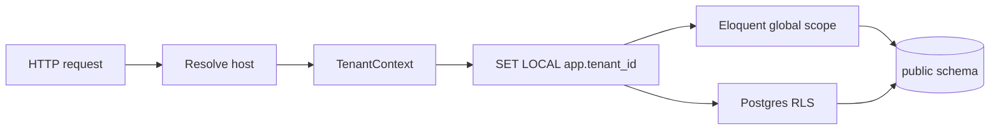
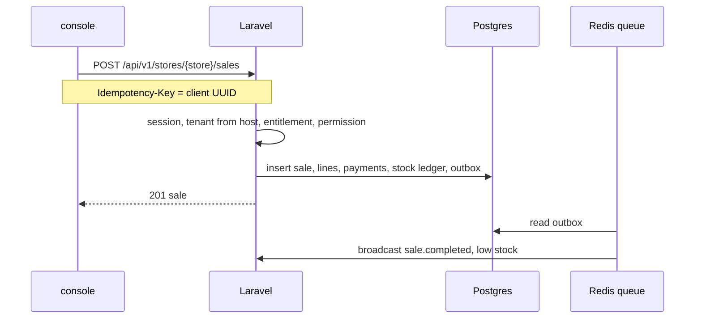
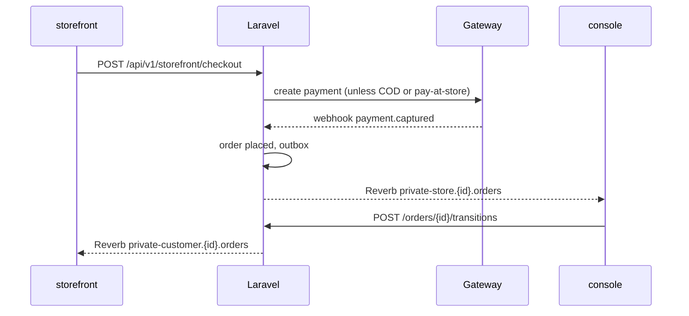
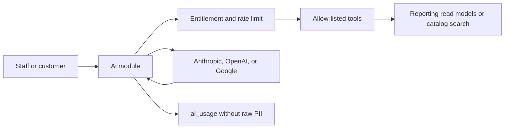
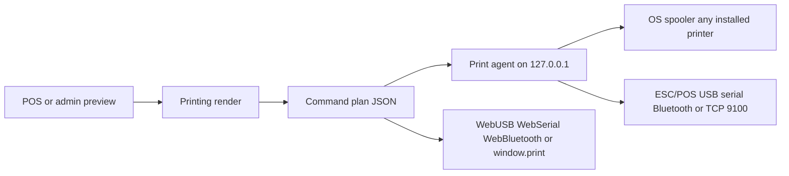

# 01 — Architecture

Decisions in this file are the ones the rest of the plan implements. The locked list is [10-open-questions.md](./10-open-questions.md).

## 1. Stack

| Concern | Choice | Why |
| --- | --- | --- |
| API | Laravel 12, or current stable as of Oct 2026. PHP 8.3+. API-only | Product boundary. Confirm the exact major at kickoff; do not invent a version |
| Admin UI, console, POS, storefront, marketing | Next.js 15, or current stable as of Oct 2026. App Router, TypeScript strict | Four apps, one language |
| DB | PostgreSQL 16+ | RLS, schemas, `timestamptz`, partitioning |
| Geo | **No PostGIS in Phase 1** | Delivery areas are pin-code lists. Radius is later and is the only reason to add PostGIS. Store `lat`/`lng` as `numeric(9,6)` nullable so a later migration can add `geography` |
| Cache, locks, rate limits, queues | Redis | One cluster, key prefixes per concern |
| Queues | Laravel Horizon | Boring, matches Laravel |
| Realtime | Laravel Reverb + Redis scaling | First-party WebSockets. Fallback in §8 |
| Search | **Typesense** | See §2 |
| Files | S3-compatible (AWS S3 in `ap-south-1`) | Flysystem |
| Auth | **Laravel Sanctum** | See §7 |
| Permissions | `spatie/laravel-permission` current stable, teams = `tenant_id`, plus nullable `store_id` | See §7 |
| Entitlements | First-party `EntitlementGate` in Plans | Separate from permissions |
| API docs | `dedoc/scramble` | OpenAPI from code, no hand-written spec |
| DTOs | `spatie/laravel-data` | Form request + DTO |
| Filters | `spatie/laravel-query-builder` | Consistent filter/sort |
| Feature flags | `laravel/pennant` | First-party, database + cache |
| 2FA | `pragmarx/google2fa` | API-only, no Fortify views |
| PDF | `spatie/laravel-pdf` (Chromium) | GST invoice layout fidelity |
| Spreadsheets | `openspout/openspout` | Streaming, chunked imports |
| Images | `intervention/image` v3 | Derivatives |
| Errors | `sentry/sentry-laravel` | See [07-devops-and-observability.md](./07-devops-and-observability.md) |
| Tests | Pest, Larastan, Deptrac, Vitest, Playwright | See [08-testing-and-quality.md](./08-testing-and-quality.md) |
| JS workspace | pnpm + Turborepo | Fits the empty `frontend/` folder |
| Charts | **Apache ECharts** | See [05-frontend-and-design-system.md](./05-frontend-and-design-system.md) |
| Print | SelfX Print Agent + ESC/POS compiler in Printing | See §16. The API never opens a socket to a shop printer |
| i18n | `next-intl`, locales `en`, `te`, `hi` | OQ-10 |
| Theme | Light and dark CSS variables, default light | OQ-10 |

Packages say "current stable" on purpose. Pin exact versions in `composer.lock` / `pnpm-lock.yaml` when the repo is initialised, not in this plan.

## 2. Search engine

**Pick: Typesense. Do not run Meilisearch in parallel.**

| Need | Typesense | Meilisearch |
| --- | --- | --- |
| Typo tolerance | Built in | Built in, slightly nicer defaults |
| Facets (category, brand, price, availability) | Strong | Adequate |
| Multi-tenant isolation | Scoped API keys can embed `filter_by` | Filter is an application convention |
| Geo later | Native | Weaker |
| Ops | Single binary now; RAFT cluster when HA is required | Single binary, simpler HA story |

Phase 1 still **proxies every query through Laravel**. The browser never holds a Typesense key. Isolation is the Laravel store filter plus Typesense as a private service. Scoped keys are there for a later mobile client.

Collections:

| Collection | Document | Filter fields |
| --- | --- | --- |
| `catalog_products` | Published masters | `category_id`, `brand_id`, `status` |
| `store_items` | Sellable items | `tenant_id`, `store_id`, `online_visible`, `category_id`, `in_stock` |

The index is a read model. PostgreSQL is the source of truth. Rebuild jobs are idempotent (`BuildSearchIndexJob` on `imports`).

## 3. Tenancy model

**Phase 1: one PostgreSQL database, one shared `public` schema, plus a separate `catalog` schema in that same database.**

Every tenant-owned table has `tenant_id`. Store-owned rows also have `store_id`.

Two enforcement layers, both required:

1. Eloquent global scope `TenantScope` set from `TenantContext`.
2. PostgreSQL RLS using `current_setting('app.tenant_id')`.

Platform requests use DB role `platform_admin` (`BYPASSRLS`) and a middleware allow-list. The app role `app_user` cannot bypass RLS. A bug that drops the global scope still returns zero foreign rows.



| Model | Isolation | Migrations | Ops | Fit |
| --- | --- | --- | --- | --- |
| Shared schema + RLS | Row policies | One migration path | Lowest | **Phase 1 default** |
| Schema per tenant | Stronger | Migrate N schemas | Painful past a few hundred | Not Phase 1 |
| Database per tenant | Strongest | Restore/move one tenant | Connection explosion | Enterprise escape hatch |

**Upgrade path for a large tenant:** move that tenant's rows to a dedicated database, point `tenants.db_target` at it, and resolve the connection in `TenantContext`. Application code keeps using `tenant_id` scopes so the move is operational, not a rewrite. Do not build the router in Phase 1. Do reserve `tenants.db_target` (`default` | future connection name).

Catalog escape hatch: logical-replicate schema `catalog` to its own instance, then drop the cross-schema FK and keep `store_items.master_product_id` as a uuid checked by a job. Same-database FK stays until catalog size or team boundaries force the split. Threshold to revisit: catalog write contention, or a second team owning ingestion. See [02-domain-and-database.md](./02-domain-and-database.md).

Tenant-aware infrastructure:

| Mechanism | Rule |
| --- | --- |
| Cache | `selfx:{env}:t:{tenantId}:{key}` |
| Locks | `selfx:{env}:t:{tenantId}:lock:{name}` |
| Queues | `tenant_id` on the job payload. Worker sets context before handle |
| Files | `tenants/{tenantId}/stores/{storeId}/...` and `catalog/...` |
| Search | `tenant_id` + `store_id` required filters |
| Broadcast | `private-tenant.{tenantId}.*`, `private-store.{storeId}.*` |
| Logs | `tenant_id` on every structured line |

Jobs without a tenant (catalog publish, partition maintenance) run as `platform_admin` and must not touch tenant tables except through an explicit tenant id argument.

## 4. Repository layout

Inspected state: `/Users/surya/Desktop/retail` contains empty `backend/` and empty `frontend/` only. **Do not move or rename them.** The monorepo wraps those trees.

```text
retail/
  package.json                 # turbo root, private
  pnpm-workspace.yaml          # frontend/apps/*, frontend/packages/*
  turbo.json
  compose.yaml                 # local postgres, redis, typesense, mailpit
  docs/plan/                   # this plan
  backend/                     # Laravel root (artisan, composer.json)
    app/Modules/{Module}/
    app/Support/Contracts/
    app/Support/Tenancy/
    database/migrations/       # all migrations, ordered here
    routes/api.php             # requires each module route file
  frontend/
    apps/marketing/
    apps/admin/
    apps/console/              # tenant dashboard and POS
    apps/storefront/
    apps/print-agent/          # local tray app, not a Next.js app. See §16
    packages/ui/               # tokens, shadcn, charts, receipt preview
    packages/api-client/       # generated from OpenAPI
    packages/config/           # eslint, tsconfig, tailwind preset
    packages/types/
```

`backend/` is not a pnpm package. Turbo tasks shell out to `composer` and `php artisan` with `workingDirectory: backend`.

### Backend module layout

```text
app/Modules/Pos/
  Actions/
  Data/
  Enums/
  Events/
  Http/Controllers/
  Http/Requests/
  Http/Resources/
  Jobs/
  Listeners/
  Models/
  Policies/
  Routes/api.php
  Providers/PosServiceProvider.php
```

Migrations stay in `backend/database/migrations` so cross-module foreign keys have one order. Filename prefix matches the module: `2026_01_01_1000_pos_create_sales_table.php`.

Controllers are thin: authorize, form request, call one Action, return one API resource. No Eloquent in controllers.

### Dependency rules

Arrows mean "may call that module's public actions or models". Anything else is a Deptrac violation. Cross-cutting contracts (`EntitlementGate`, `TenantDirectory`, `Clock`, `Money`) live in `app/Support`.

| Module | May depend on |
| --- | --- |
| Identity | Support |
| Audit | Identity, Support |
| Tenancy | Identity, Support |
| Plans | Tenancy, Support |
| Payments | Tenancy, Support |
| Billing | Plans, Payments, Printing, Tenancy, Support |
| Customers | Tenancy, Support |
| Catalog | Support only. `tenant_id` on submissions is a bare uuid |
| Inventory | Catalog, Tenancy, Support |
| Storefront | Catalog, Inventory, Tenancy, Support |
| Pos | Inventory, Customers, Payments, Printing, Tenancy, Support |
| Orders | Inventory, Customers, Payments, Storefront, Delivery, Printing, Tenancy, Support |
| Delivery | Tenancy, Customers, Support |
| Printing | Tenancy, Support. No dependency on Pos |
| Notifications | Tenancy, Printing, Support |
| Ai | Tenancy, Plans, Reporting, Catalog, Support |
| Cms | Support |
| Apps | Plans, Tenancy, Support |
| Reporting | Printing, plus read-only models of other modules. Deptrac exception, listed in the yaml. No writes except `report_runs` |

Cycles are broken with domain events. Delivery does not import Order models. Orders listens for `delivery.completed`.

Everyone emits audit by raising `AuditableAction`. The Audit listener writes `audit_logs`. Modules do not insert into `audit_logs` directly.

CI: `deptrac/deptrac` on the backend pipeline. Fail the build on an unknown dependency.

## 5. Request flows

### Staff POS sale



### Online order



If the socket is down, both clients poll `GET /api/v1/streams/{channel}/events?after=`.

### Catalog add

Tenant searches `GET /api/v1/catalog/products` (published masters only), then `POST /api/v1/stores/{store}/items/from-catalog` with a margin rule. The action inserts `store_items` pointing at `catalog.products`. It copies nothing except denormalised search text.

## 6. Subdomain strategy

`APP_DOMAIN` is an env value. The domain is not fixed (OQ-04). Examples below use `retail.selfx.test` locally and the placeholder `retail.selfx.in` in production.

Wildcard TLS covers one label. Two certificates:

| Zone | Pattern | App |
| --- | --- | --- |
| Apex | `{APP_DOMAIN}`, `www.{APP_DOMAIN}` | marketing |
| Platform | `admin.{APP_DOMAIN}` | admin |
| Tenants | `{tenantSlug}.{APP_DOMAIN}` | console |
| Shops | `{publicSlug}.shop.{APP_DOMAIN}` | storefront |

`{publicSlug}` is globally unique (`stores.public_slug`). Organization shop host uses the org tenant slug and lists stores. A store shop host serves that store only.

Reserved slugs (reject on create): `www`, `admin`, `api`, `app`, `shop`, `mail`, `static`, `cdn`, `status`, `docs`, `help`, `support`, `billing`, `assets`, `images`, `catalog`, `platform`, `selfx`, `root`, `null`, `test`, `demo`, `staging`, `localhost`.

Local dev: dnsmasq `address=/retail.selfx.test/127.0.0.1` and mkcert for `*.retail.selfx.test` and `*.shop.retail.selfx.test`. `/etc/hosts` cannot express the wildcard. Caddy (or Herd) terminates TLS and proxies `/api` and `/broadcasting` to Laravel on the **same host** the browser used.

### Same-origin API

Do **not** put the session cookie on `Domain=.retail.selfx.in`. That would send the admin session to every tenant host.

Each frontend host reverse-proxies:

- `/api/*` → Laravel
- `/broadcasting/*` → Reverb auth and the websocket upgrade
- `/sanctum/csrf-cookie` → Laravel

The browser sees one origin. Sanctum uses a host-only session cookie. `SANCTUM_STATEFUL_DOMAINS` is implemented as a pattern check (`*.{APP_DOMAIN}`, `*.shop.{APP_DOMAIN}`), not a static list of tenants.

Laravel reads the tenant from `X-Forwarded-Host`, which only the proxy may set. Direct hits on the API port in production are firewalled.

Future native apps call `https://api.{APP_DOMAIN}` with a Sanctum personal access token. That host does not issue session cookies.

Custom domains (later): `store_domains.host` maps to a store, still proxied to the storefront app. Phase 1 does not route them.

## 7. Auth

Three flows, one `users` table, column `kind` = `platform` | `staff` | `customer`.

| Flow | Credential | Session |
| --- | --- | --- |
| Platform | Email + password + TOTP | Host-only cookie on `admin.{APP_DOMAIN}` |
| Staff | Email + password. TOTP required for owners. Optional for other staff | Host-only cookie on `{tenant}.{APP_DOMAIN}` |
| Staff POS switch | 4–6 digit PIN, separate hash, same device session | Does not replace the password session; sets `acting_user_id` |
| Customer | Phone OTP | Host-only cookie on the shop host |

Password hashing: Argon2id. Staff and platform passwords are never stored for customers.

Forced password change: `users.must_change_password`. Middleware blocks every route except the change-password endpoint until cleared. Welcome email contains a single-use set-password link, not the temporary password in the body. The create-tenant API still accepts an initial password so support can hand it over out of band; the user must change it at first login.

2FA: TOTP secret encrypted at rest, 8 recovery codes hashed, required for every `platform` user and every tenant owner.

Sessions: Laravel `sessions` table, device label from user agent, list and revoke screens. Idle timeout 12 hours for staff, 30 minutes for platform, 30 days sliding for customers.

Brute force: Redis counters. Lock the account after 10 password failures in an hour. Login rate limit 5/minute/IP. OTP rules are in [04-module-breakdown.md](./04-module-breakdown.md) Notifications.

Impersonation: `POST /api/v1/platform/tenants/{id}/impersonate` with a reason. Creates `impersonation_sessions` (15–60 minutes). Console shows a persistent banner. Audit records both ids. While impersonating, these are forbidden: billing changes, gateway credential reads, staff password resets, API key creation. Leave via `POST /api/v1/platform/impersonation/leave`.

### Permissions and entitlements

A request is allowed only if both pass:

1. Permission: Spatie team = `tenant_id`. Pivot `model_has_roles.store_id` nullable. Null means all stores. Custom registrar checks store-specific row first, then tenant-wide.
2. Entitlement: `EntitlementGate::allows(tenant, featureKey)` and `EntitlementGate::withinLimit(tenant, limitKey, current)`.

Cache: Redis hash `selfx:{env}:t:{id}:entitlements` TTL 10 minutes, invalidated on plan change and override write. Database is the source of truth. If Redis is down, read the database; do not fail open.

UI gating mirrors the same feature keys from `GET /api/v1/entitlements`. It is not a control.

Platform users do not use tenant teams. They have platform roles only.

## 8. Realtime and the fallback

Reverb channels (private, auth via `/broadcasting/auth` under the session):

| Channel | Events |
| --- | --- |
| `private-store.{storeId}.orders` | `order.placed`, `order.status.changed` |
| `private-customer.{customerId}.orders` | `order.status.changed` for that customer |
| `private-store.{storeId}.stock` | `stock.low`, `stock.negative` |
| `private-tenant.{tenantId}.system` | entitlement warnings, import finished |
| `private-platform.health` | failed job spikes, gateway errors |

Auth callback checks store membership or customer ownership. Super admin may join `private-platform.health` only.

**Missed-event recovery:** the domain outbox has a `bigserial` `sequence`. Each broadcast payload includes `sequence`. On reconnect the client calls `GET /api/v1/streams/{channel}/events?after={sequence}`. Poll every 10s when the socket is closed, and once immediately after it opens. The poll is the fallback even if Reverb is disabled (`REALTIME_DRIVER=poll`).

Do not rely on "the socket delivered it" for stock or payment state. The database commit is the fact; the socket is a hint.

## 9. Async

| Queue | Workers (start) | Work |
| --- | --- | --- |
| `critical` | 2 | Payment webhook handling, OTP send |
| `outbox` | 2 | Publish domain events, fan-out broadcasts |
| `default` | 2 | Provision steps, general |
| `notifications` | 2 | Email, SMS, push, WhatsApp adapter |
| `webhooks` | 1 | Outbound tenant webhooks |
| `imports` | 1 | Catalog and item imports, search rebuild |
| `reports` | 1 | Aggregates, exports |
| `ai` | 1 | Provider calls |
| `media` | 1 | Image derivatives, virus-scan hook |

Retries: 3 for notifications (backoff 30s, 2m, 10m), 5 for webhooks, 3 for imports per chunk. Failed jobs stay in Horizon's failed store. A `dead` queue is not a second broker: Horizon failed jobs **are** the dead letter. Replay is `POST /api/v1/platform/failed-jobs/{id}/retry`.

Idempotent jobs: key on the business id (`sale_id`, `import_row_id`, `webhook_receipts.provider_event_id`). Handlers check a `processed_at` column or a unique constraint before side effects.

Scheduler (single `schedule:work` or Forge scheduler, never both):

| Job | When |
| --- | --- |
| `AggregateDashboardMetricsJob` | Every minute for today; nightly full rebuild |
| `DunningRetryJob` | Hourly |
| `ExpireTrialsJob` | Hourly |
| `LowStockScanJob`, `ExpiryScanJob` | Hourly |
| `ReconciliationPullJob` | Nightly |
| `CreateNextPartitionsJob` | Weekly |
| `PruneIdempotencyKeysJob` | Daily, keep 7 days |
| `ReportScheduleJob` | Every 5 minutes, dispatches due schedules |
| `SyncExternalCatalogJob` | Per source cron |

Long imports: controller stores the file and inserts `import_batches` (`status=uploaded`). A job chunks 500 rows into `import_rows` and dispatches `ImportCatalogChunkJob` per chunk. Each chunk commits. Restart resumes from `status=pending` rows. Dry-run uses the same path with `commit=false`.

## 10. Payments placement

Two owners, one adapter, one ledger:

| Owner | Credentials row | Used for |
| --- | --- | --- |
| Platform | `payment_gateways.owner = platform` | SelfX subscription invoices |
| Tenant store | `owner = tenant`, `store_id` set | Checkout and POS payment links |

PCI: no PAN, no CVV. Redirect, UPI intent, or gateway checkout.js. Scope target SAQ-A. See [06-security-and-compliance.md](./06-security-and-compliance.md).

## 11. AI placement



The model never receives a database connection. Tools are PHP classes with typed arguments (`SalesTotal`, `TopProducts`, `LowStock`, `CatalogSearch`). Results include a citation: tool name, arguments, `generated_at`. Customer assistant tools are a smaller set, scoped to the current store's visible catalog. Details in [04-module-breakdown.md](./04-module-breakdown.md).

## 12. Scalability

Phase 1 is stateless PHP behind a load balancer, Horizon workers scaled by queue depth, one Postgres primary, Redis, one Typesense node.

| Signal | Move |
| --- | --- |
| API CPU | More app instances. No session affinity except Reverb |
| Read-heavy dashboards | Read replica for Reporting queries |
| Reverb connections | Reverb nodes + Redis pub/sub, already in the plan |
| Catalog ingestion slows checkout | Split `catalog` schema to its own Postgres |
| Notification volume | Split Notifications workers first; a separate service only after that saturates |
| Search CPU | Typesense cluster, still behind Laravel |
| One enterprise tenant | `tenants.db_target` dedicated database |

Do not introduce extra deployable services in Phase 1.

## 13. Environments

| Env | Purpose |
| --- | --- |
| `local` | compose + dnsmasq + mkcert |
| `dev` | Shared, resettable, fake gateways |
| `staging` | Production-like, gateway test mode, masked data |
| `production` | Live keys, RLS enforced, BYPASSRLS role not used by the web container |

Same Docker image across dev, staging, production. Config is env and secrets only. See [07-devops-and-observability.md](./07-devops-and-observability.md).

## 14. Embedded decision records

| ID | Decision |
| --- | --- |
| ADR-001 | Shared schema, `tenant_id` + `store_id`, RLS and global scopes |
| ADR-002 | `catalog` schema, same database, `store_items` FK, search as read model |
| ADR-003 | UUIDv7 primary keys from PHP (`Symfony\Component\Uid\UuidV7`). Postgres 16 has no `uuidv7()` |
| ADR-004 | Sanctum host-only cookies via same-origin `/api` proxy. PAT tokens later for native |
| ADR-005 | Typesense, queried only from Laravel |
| ADR-006 | No PostGIS until radius delivery |
| ADR-007 | Phase 1 offline = catalog cache + cash-sale outbox |
| ADR-008 | ECharts as the only chart library |
| ADR-009 | `sales` and `orders` are different aggregates |
| ADR-010 | Organization is `tenants.kind`. SelfX bills the tenant once. Stores are not subscriptions |
| ADR-011 | Money is `bigint` paise. Rates are basis points |
| ADR-012 | AI reads metrics through tools, never SQL |
| ADR-013 | Customers is its own module |
| ADR-014 | Printing renders a command plan. The print agent or the browser executes it. Laravel does not connect to printer IPs |
| ADR-015 | Locales `en`, `te`, `hi`. Light and dark theme in Phase 1 |
| ADR-016 | Payment and catalog providers are registries. Nothing prepaid or remote is on until configured |

## 15. Caching (what, where, TTL)

| Data | Where | TTL | Invalidate |
| --- | --- | --- | --- |
| Entitlements | Redis hash | 10 min | Plan change, override |
| Published CMS page | Redis + Next.js tag | 60s ISR | CMS publish |
| Storefront home payload | Redis | 60s | Banner, section, item visibility |
| POS bootstrap (prices, barcodes) | Redis, then IndexedDB | 5 min server; client until shift close | Price change pushes `pos.bootstrap.stale` |
| Dashboard aggregates | Table `daily_store_metrics` | Refreshed by job | Not request-time |
| Platform analytics | Table `platform_daily_metrics` | 1 min job | Not request-time |
| OTP and rate limits | Redis | As the window | TTL only |
| Idempotency responses | Postgres 7 days | — | Prune job |

Query budget: list endpoints p95 under 100 ms on staging fixtures; dashboard summary under 150 ms because it reads the aggregate table. N+1 fails a Pest test that enables query logging on feature tests for `SaleResource` and `OrderResource`. Pagination is cursor-only on tenant tables. Offset pagination is forbidden on `sales`, `orders`, `audit_logs`, and ledger tables.

## 16. Printing

POS, pick lists, delivery notes, barcode labels, SaaS invoices, and report PDFs all go through `App\Modules\Printing`. The sale transaction does not wait on a physical printer. It stores the sale, then the terminal asks Printing for a render and delivers it locally.



### What "any connected printer" means

A website cannot open USB, serial, Bluetooth, or a shop LAN port by itself. Phase 1 therefore has three transports. The first one that is paired is the one the counter uses.

| Transport | When it is used | Printers it reaches |
| --- | --- | --- |
| `agent` | SelfX Print Agent is running on the POS machine | Every printer the OS spooler lists, plus ESC/POS over USB, serial, Bluetooth, and raw port 9100 |
| `browser_raw` | Chrome or Edge, no agent | ESC/POS devices that expose WebUSB, WebSerial, or WebBluetooth |
| `browser_dialog` | Anything else, and all A4 or label jobs the user wants on a normal printer | Whatever the OS print dialog can see |

The agent is `frontend/apps/print-agent`. It is a small signed tray binary (Go; one static binary for Windows, macOS, and Linux), not a Next.js app. Apps manager distributes it. It listens on `127.0.0.1:27182` only.

Pairing: the agent shows a 4-digit code, the cashier types it once, both sides store a device token on `pos_devices`. Later calls send that token. Origin allow-list is `https://*.{APP_DOMAIN}` and the local wildcard. Other origins get no response body.

Discovery:

- OS printers: Windows Print Spooler and CUPS, on demand.
- USB: printers the agent can see, plus WebUSB `navigator.usb.getDevices()` after a user gesture.
- Network: **the agent** scans the local subnet for TCP 9100 when the cashier presses Scan. Timeout 200 ms, cap one /24. Laravel never scans and never connects to those addresses.

Status heartbeats every 15 seconds (`online`, `offline`, `paper_out` when the transport reports it). POS shows the chip. A sale still completes if the printer is offline; the job stays `queued` on the terminal and reprints.

### Drivers

`PrintDriver` implementations:

| Driver | Role |
| --- | --- |
| `escpos` | Default for 58 mm and 80 mm. Cut, feed, bold, align, barcode, QR, drawer kick |
| `system` | PDF or HTML to the OS spooler. Any laser, inkjet, or PDF printer |
| `epson_epos` | Optional. Agent calls the printer's ePOS HTTP endpoint on the LAN |
| `star_webprnt` | Optional. Same rule: agent, not Laravel |
| `sdk` | Empty registration point for a later vendor SDK |

Adding a driver is a class plus a capability flag. POS does not gain a branch per brand.

### Layouts

Templates are a block list, not HTML and not raw ESC bytes. Block types: `text`, `spacer`, `rule`, `columns`, `image`, `barcode`, `qr`, `feed`, `cut`. Text style is align (`left`,`center`,`right`), weight (`regular`,`bold`), size (`sm`,`md`,`lg`), and uppercase. Spacer and feed are integers 0–8 lines. Cut is `none`, `partial`, or `full`, and only as the last block. The compiler is the only code that emits `GS V` or `ESC p`. A template cannot smuggle those bytes.

Non-Latin lines (Telugu, Hindi) rasterize to a monochrome image in the agent using bundled Noto Sans Telugu and Noto Sans Devanagari, because most thermal code pages have no glyphs for them. Latin stays as text so a simple bill stays fast.

Super Admin edits the platform default for every document kind and previews it with fixture data. A tenant owner or manager may copy that default and change layout, cut, spacing, and text style for their stores. Locked blocks on a tax document: invoice number, GSTIN, and the tax table. OTP message text is not a print template.

Preview never writes a sale, an invoice, or a `print_jobs` row. Test print does write a `print_jobs` row with `purpose=test`.

### Server boundary

`POST /print-jobs` returns the command plan and a job id. The browser or the agent posts `printed` or `failed`. Receipt PDF for email is rendered by `spatie/laravel-pdf` from the same block document, on the `reports` queue, and stored in S3. That path is for sharing, not for the thermal printer.
