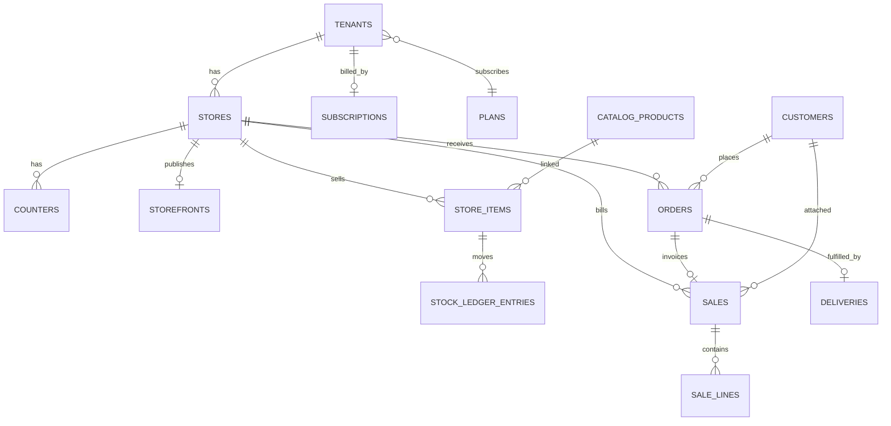
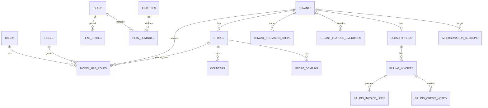
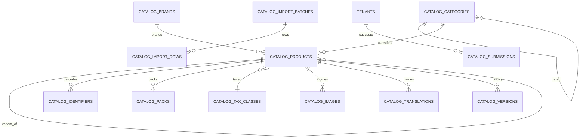
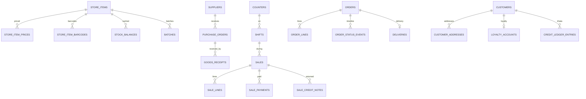
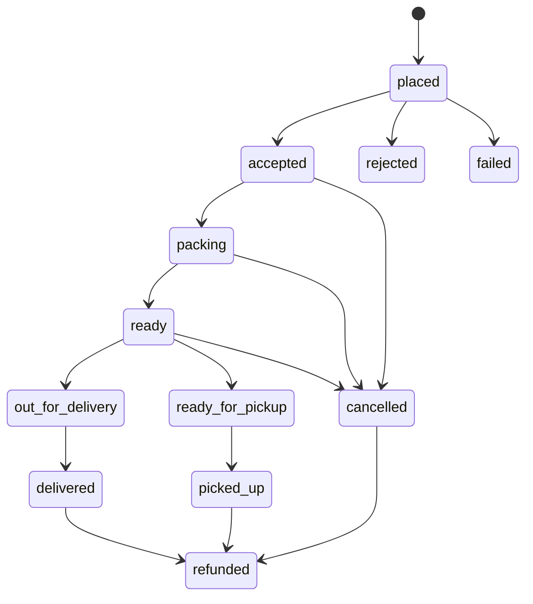

# 02 — Domain and database

PostgreSQL 16+. One database. Schema `public` for tenant and platform data. Schema `catalog` for the global product master. Money is `bigint` paise. Rates are integer basis points. Time is `timestamptz` UTC. Primary keys are UUIDv7 unless noted.

Related: [01-architecture.md](./01-architecture.md) ADR-001 through ADR-003, [03-api-design.md](./03-api-design.md).

## 1. Conventions

| Rule | Standard |
| --- | --- |
| Tables | plural snake_case |
| PK | `id uuid` UUIDv7, generated in PHP before insert |
| FK | `{singular}_id uuid` plus an index |
| Money | `*_paise bigint not null` |
| Rates | `*_bps integer not null` |
| Status | `text` + check constraint, mirrored by a PHP enum. No PostgreSQL enum types |
| Soft delete | `deleted_at` on business entities. **Never** on ledgers, outbox, audit, webhook receipts |
| Unique + soft delete | partial unique index `where deleted_at is null` |
| Tenant tables | `tenant_id uuid not null` indexed, RLS policy |
| Store tables | `store_id` as well |
| JSON | `jsonb`, only for snapshots and rarely queried blobs |
| Names | English singular concept, no Stocky names |

High-volume tables add a second key:

| Table | Extra key | Why |
| --- | --- | --- |
| `domain_outbox` | `sequence bigserial` | Client cursor |
| `audit_logs`, `stock_ledger_entries`, `payment_ledger_entries`, `notification_messages` | `sequence bigserial` | Partition ordering and cursors |

The uuid remains the external id. Do not expose `sequence` except as a stream cursor.

### Index standards

- Every FK is indexed.
- Tenant lists: `(tenant_id, created_at desc)`.
- Lookups the UI filters on: composite with `tenant_id` first.
- Barcodes: unique on the normalised value where the business rule says unique.
- `CREATE INDEX CONCURRENTLY` in a migration that does not run inside a transaction (`Schema::disableForeignKeyConstraints` is not a substitute).

### Row level security

For each tenant-owned table:

```sql
alter table sales enable row level security;
alter table sales force row level security;
create policy sales_tenant on sales
  using (tenant_id = current_setting('app.tenant_id', true)::uuid)
  with check (tenant_id = current_setting('app.tenant_id', true)::uuid);
```

`app_user` is `NOSUPERUSER NOBYPASSRLS`. `platform_admin` is `BYPASSRLS` and is used only by the platform guard and scheduled jobs. The web container's default connection is `app_user`.

Catalog tables are not tenant-RLS. Grants:

| Role | `catalog` schema | `public` tenant tables |
| --- | --- | --- |
| `app_user` | `SELECT` on published-facing tables. `INSERT` on `product_submissions` only | CRUD subject to RLS |
| `catalog_writer` | CRUD on `catalog`. No access to `sales` or `orders` | None |
| `platform_admin` | CRUD | Bypass RLS |

Import workers use `catalog_writer`. They cannot update a sale even if a job is buggy.

### Zero-downtime migrations

Expand then contract, across two deploys:

1. Add a nullable column or new table. Old code ignores it.
2. Backfill in a queued chunk job.
3. New code writes both.
4. Next release: enforce `NOT NULL`, drop the old column.

Forbidden in a single rolling deploy: renaming a column the old code still selects, adding a `NOT NULL` column without a default the old code omits, a long `ACCESS EXCLUSIVE` rewrite. Indexes that could lock use `CONCURRENTLY`.

### Partitioning

Partition from the first migration (monthly range on `created_at`, default partition, job creates the next three months):

- `audit_logs`
- `stock_ledger_entries`
- `payment_ledger_entries`
- `notification_messages`

Do not partition `sales` or `orders` until a table passes roughly 50 million rows. Retrofitting partitions is planned work; starting the four append-only tables partitioned is cheap.

### Seed

- Feature registry and three plans with **placeholder** INR prices.
- Units: `pcs`, `kg`, `g`, `l`, `ml`, `pack`.
- Indian state codes for place of supply.
- Tax classes 0, 5, 12, 18, 28 percent as editable rows, not constants.
- Platform roles, reserved slugs.
- CMS pages `privacy` and `terms` as drafts with real headings and empty body, not lorem ipsum.
- No sample products and no demo sales.

## 2. Identity choices

**UUIDv7 vs ULID vs bigint.** UUIDv7 wins. It fits the `uuid` type, sorts by time so indexes do not fragment like UUIDv4, and needs no central generator. Symfony's `UuidV7` ships with Laravel. ULID is text and less native. Bigint is smaller but leaks volume and forces a second public id. Postgres 16 cannot generate v7; the app does.

**Money.** `numeric` money drifts. Paise `bigint` does not. ₹21.5 million fits in 32-bit; stock valuation and GMV do not. Always `bigint`.

**Inclusive tax storage.** Persist both the entered unit price and the extracted components. Never recompute an old invoice from current rates.

## 3. Tenancy and catalog decisions

### Tenant, organization, store

```text
tenants (kind = single_store | organization)
  └── stores (1 for single_store, N for organization, capped by limit.stores)
        └── counters
        └── storefront (one per store)
  └── storefront (one extra, scope = organization, only when kind = organization)
```

An organization does not have child tenants. **Decided (OQ-03):** SelfX bills the tenant. A single-store tenant has one subscription. An organization is one tenant and has one subscription. Stores are locations, capped by `limit.stores`, and are not billing accounts.

The organization shop host lists those stores. The customer picks one. The next page is that store's shop host. One cart, one `store_id` (OQ-07).

Trade-off: per-store SelfX plans would match "each store buys Professional" but double-charge chains and complicate entitlements. Rejected for Phase 1. Add-on SKU can come later without a schema break (`subscriptions` already allow one plan; add `subscription_addons` then).

### Why `store_items` link instead of copy

| Approach | Outcome |
| --- | --- |
| Copy master columns into the store | Drift. Barcode fixes never reach the store. Rejected |
| Link `store_items.master_product_id` | One correction, every store sees the new name and image. **Chosen** |
| Store-private item (`master_product_id` null) | Allowed for items the catalog does not have. Tenant may submit a suggestion |

Overrides that stay local: selling price, MRP, online visibility, name override, extra store barcodes, stock. Display name is `coalesce(name_override, catalog name)`.

### Catalog schema vs a catalog service

Same database, schema `catalog`, role `catalog_writer`, module `Catalog` that Deptrac forbids from importing Pos, Orders, or Inventory.

Trade-off: a separate service isolates load and teams, and loses the FK. A schema keeps the FK and a hard grant boundary. That is the right Phase 1 spot. Scale-out is logical replication of `catalog`, then replace the FK with a uuid + reconciliation job. Application code already treats the master as read-only from tenant routes, so the later split does not rewrite POS.

Search index is not a table of record. A destroyed Typesense node is rebuilt from Postgres.

## 4. Sales vs orders

| | Sale | Order |
| --- | --- | --- |
| Table | `sales` | `orders` |
| When | POS payment, or when an online order becomes a tax invoice | Customer checkout |
| Stock | Ledger written when the sale completes | Reserved at `accepted` (recommendation), deducted when the linked sale completes |
| Document | Tax invoice / receipt | Order confirmation, then invoice via the sale |

Online prepaid: create the `sales` row when payment is captured and the tenant accepts. COD: create the `sales` row on `delivered`. Both rules live in `Orders` actions so POS does not special-case them. `sales.order_id` is nullable unique.

This split is deliberate. A POS bill must exist offline and must have a gapless invoice number. An online order is a workflow. Merging them into one table makes the state machine and the fiscal series fight each other.

Stock reservation trade-off: reserve-on-accept can strand stock if the tenant never packs. A job releases reservations stuck in `accepted` or `packing` for more than the store's `reservation_hours` (default 24).

## 5. ERD — overview



## 6. ERD — identity, tenancy, plans, billing



## 7. ERD — catalog



## 8. ERD — inventory, POS, orders



## 9. Tables by module

Columns listed are the ones an implementer must not invent differently. Add `created_at`, `updated_at` everywhere except append-only ledgers, which have `created_at` only. Soft-delete column called out when used.

### Identity

| Table | Key columns | Indexes |
| --- | --- | --- |
| `users` | `kind`, `name`, `email`, `phone_e164`, `password`, `must_change_password`, `two_factor_secret` encrypted, `two_factor_confirmed_at`, `locale` (`en`,`te`,`hi`), `theme` (`light`,`dark`), `status` | unique email where not null; unique phone where not null |
| `staff_profiles` | `user_id`, `tenant_id`, `display_name`, `status` | unique `(tenant_id, user_id)` |
| `staff_pins` | `user_id`, `tenant_id`, `pin_hash` | unique `(tenant_id, user_id)` |
| `sessions` | Laravel default + `tenant_id` nullable, `impersonator_id` nullable | `user_id` |
| `personal_access_tokens` | Sanctum | — |
| `login_attempts` | `email`, `ip`, `succeeded`, `created_at` | `(email, created_at)` |
| `two_factor_recovery_codes` | `user_id`, `code_hash`, `used_at` | `user_id` |
| `password_reset_tokens` | Laravel | — |

Platform users have no `staff_profiles` row. Customers who have logged in have `users.kind = customer`. The retail profile is `customers`, not `users`.

Spatie tables, with the extra store column:

| Table | Key columns | Indexes |
| --- | --- | --- |
| `roles` | `tenant_id` nullable (null = platform or template), `name`, `guard_name` | unique `(tenant_id, name, guard_name)` |
| `permissions` | `name`, `guard_name` | unique `(name, guard_name)` |
| `role_has_permissions` | `role_id`, `permission_id` | pair |
| `model_has_roles` | `role_id`, `model_id`, `model_type`, `tenant_id`, `store_id` nullable | `(model_id, tenant_id, store_id)` |

`store_id` null means the role applies to every store in the tenant. Attendance punches (M10): `attendance_punches` (`tenant_id`, `user_id`, `store_id`, `direction` `in|out`, `occurred_at`).

### Tenancy

| Table | Key columns | Indexes |
| --- | --- | --- |
| `tenants` | `kind`, `name`, `legal_name`, `slug`, `email`, `phone_e164`, `gstin`, `pan`, `status` (`provisioning`,`active`,`suspended`,`cancelled`), `timezone`, `currency` default `INR`, `db_target` default `default`, `provision_status`, `deleted_at` | unique `slug`; unique `gstin` where not null |
| `reserved_slugs` | `slug` | unique |
| `stores` | `tenant_id`, `name`, `code`, `public_slug`, `gstin`, `address_line`, `city`, `state_code`, `pincode`, `lat`, `lng`, `timezone`, `gst_pricing_mode` (`inclusive`,`exclusive`), `round_to_rupee`, `status`, `is_default`, `settings jsonb`, `deleted_at` | unique `(tenant_id, code)`; unique `public_slug`; `(tenant_id, status)` |
| `store_domains` | `store_id`, `tenant_id`, `host`, `type` (`platform`,`custom`), `verified_at`, `is_primary` | unique `host` |
| `counters` | `store_id`, `tenant_id`, `name`, `code`, `status` | unique `(store_id, code)` |
| `tenant_provision_steps` | `tenant_id`, `step`, `status`, `attempts`, `last_error`, `completed_at` | unique `(tenant_id, step)` |
| `invoice_series` | `tenant_id`, `store_id`, `counter_id`, `fiscal_year`, `prefix`, `next_number` | unique `(counter_id, fiscal_year)` |
| `invoice_number_blocks` | `series_id`, `start_number`, `end_number`, `claimed_by_device`, `expires_at` | `(series_id, expires_at)` |

`stores.lat` / `lng` are nullable decimals. No geography type.

Provisioning steps, in order, each idempotent: `owner_user`, `default_store`, `default_counter`, `invoice_series`, `roles`, `owner_assignment`, `storefront`, `settings`, `welcome_email`, `mark_active`.

### Plans

| Table | Key columns | Indexes |
| --- | --- | --- |
| `features` | `key` unique, `name`, `value_type` (`boolean`,`integer`), `description`, `show_on_pricing` | unique `key` |
| `plans` | `code`, `name`, `status`, `sort`, `is_public`, `deleted_at` | unique `code` |
| `plan_prices` | `plan_id`, `cycle` (`monthly`,`quarterly`,`yearly`), `amount_paise`, `compare_at_paise` nullable, `currency`, `trial_days`, `active` | unique `(plan_id, cycle)` where active |
| `plan_features` | `plan_id`, `feature_id`, `value` (`-1` means unlimited for integer keys, `0/1` for boolean) | unique `(plan_id, feature_id)` |
| `tenant_feature_overrides` | `tenant_id`, `feature_id`, `value`, `reason`, `expires_at`, `created_by` | unique `(tenant_id, feature_id)` |

Feature keys (registry, seed and a PHP enum that must match):

| Key | Type | Meaning |
| --- | --- | --- |
| `module.pos` | bool | POS |
| `module.inventory` | bool | Stock and purchasing |
| `module.storefront` | bool | Online store |
| `module.delivery` | bool | Own-staff delivery |
| `module.customers` | bool | CRM |
| `module.loyalty` | bool | Points |
| `module.khata` | bool | Customer credit |
| `module.reports_advanced` | bool | Scheduled reports and GST pack |
| `module.price_lists` | bool | Extra price lists and scheduled prices. Default list is on every plan |
| `module.ai_reports` | bool | NL reports |
| `module.ai_product_create` | bool | AI product draft |
| `module.ai_assistant` | bool | PWA assistant |
| `module.accounting_export` | bool | Tally-shaped CSV |
| `module.webhooks` | bool | Outbound webhooks |
| `module.api_keys` | bool | Open API |
| `module.custom_domain` | bool | Always false in Phase 1 |
| `module.multi_store` | bool | Organization stores |
| `module.offline_pos` | bool | Cash outbox |
| `module.whatsapp` | bool | WhatsApp sends |
| `apps.android` `apps.ios` `apps.windows` `apps.desktop` | bool | Download gates |
| `limit.stores` `limit.staff` `limit.products` `limit.orders_per_month` `limit.storage_mb` `limit.sms_per_month` `limit.ai_credits_per_month` `limit.counters` | int | Quotas |

Placeholder seed (OQ-03, editable in Super Admin, not a code change): Starter ₹0, Professional ₹149900 paise / month, Enterprise ₹499900 paise / month. Yearly and quarterly rows exist with a 15% compare-at. Professional `trial_days` is 14. Grace after `past_due` is 7 days.

Starter entitlements to seed: one store, two staff, 100 products, 300 orders/month, 500 MB, 50 SMS, 0 AI credits, 1 counter, one price list; modules pos, inventory, storefront, customers. Professional adds delivery, loyalty, khata, advanced reports, price lists, offline POS, 10 staff, 5000 products. Enterprise adds multi-store, API keys, webhooks, accounting export, AI, app downloads, higher limits. Edit in admin; do not hardcode in policies.

### Billing

Platform invoices are **not** POS `sales`. Different tables, different series (`SFX-2526-000001`).

| Table | Key columns | Indexes |
| --- | --- | --- |
| `subscriptions` | `tenant_id` unique, `plan_id`, `plan_price_id`, `status` (`trialing`,`active`,`past_due`,`grace`,`suspended`,`cancelled`), `trial_ends_at`, `current_period_start`, `current_period_end`, `cancel_at_period_end`, `grace_ends_at` | `status` |
| `billing_coupons` | `code`, `percent_bps` or `amount_paise` (one required), `duration` (`once`,`repeating`,`forever`), `max_redemptions`, `active` | unique `code` |
| `billing_coupon_redemptions` | `coupon_id`, `tenant_id`, `subscription_id` | `(coupon_id, tenant_id)` |
| `billing_invoices` | `tenant_id`, `subscription_id`, `number`, `status` (`draft`,`open`,`paid`,`void`,`uncollectible`), `place_of_supply_state`, `subtotal_paise`, `cgst_paise`, `sgst_paise`, `igst_paise`, `total_paise`, `issued_at`, `due_at`, `pdf_path`, `supplier_gstin_snapshot`, `buyer_gstin_snapshot` | unique `number` |
| `billing_invoice_lines` | `invoice_id`, `description`, `sac`, `quantity`, `unit_paise`, `tax_bps` | `invoice_id` |
| `billing_credit_notes` | `invoice_id`, `number`, `amount_paise`, `reason`, `pdf_path` | unique `number` |
| `billing_payments` | `invoice_id`, `tenant_id`, `method` (`gateway`,`manual`), `amount_paise`, `utr`, `status`, `payment_transaction_id` nullable | `invoice_id` |
| `dunning_attempts` | `invoice_id`, `attempt`, `next_attempt_at`, `last_error` | `(next_attempt_at)` |

Proration columns on the invoice line: `proration_from`, `proration_to`, `kind` (`recurring`,`proration_credit`,`proration_charge`). Upgrade charges now. Downgrade applies at period end unless the caller passes `when=now` and usage fits the lower limits.

MRR is computed by `AggregateDashboardMetricsJob` from active subscriptions normalised to months, stored on `platform_daily_metrics`. It is not a live sum on each dashboard hit.

### Payments

| Table | Key columns | Indexes |
| --- | --- | --- |
| `payment_gateways` | `owner` (`platform`,`tenant`), `tenant_id` nullable, `store_id` nullable, `provider` (`razorpay`,`cashfree`,`phonepe`,`paytm`,`cod`,`pay_at_store`,`manual`), `mode` (`test`,`live`), `credentials_ciphertext`, `credentials_nonce`, `status`, `is_default` | `(store_id, provider, mode)` |
| `payment_transactions` | `tenant_id` nullable, `store_id` nullable, `gateway_id`, `purpose` (`subscription`,`sale`,`order`,`refund`), `reference_type`, `reference_id`, `amount_paise`, `status` (`pending`,`authorized`,`captured`,`failed`,`refunded`), `provider_ref`, `idempotency_key`, `currency` | unique `(gateway_id, provider_ref)`; unique `idempotency_key` per tenant |
| `payment_ledger_entries` | `sequence`, `transaction_id`, `tenant_id`, `direction` (`debit`,`credit`), `amount_paise`, `account` (`receivable`,`cash`,`gateway_clearing`,`refund`), `created_at` | partitioned; `(tenant_id, created_at)` |
| `refunds` | `transaction_id`, `amount_paise`, `status`, `reason`, `provider_ref` | `transaction_id` |
| `webhook_receipts` | `provider`, `provider_event_id`, `signature_ok`, `payload jsonb`, `processed_at` | unique `(provider, provider_event_id)` |
| `reconciliation_lines` | `gateway_id`, `provider_ref`, `amount_paise`, `matched_transaction_id`, `status` (`matched`,`unmatched`) | `(gateway_id, status)` |

`cod` and `pay_at_store` are providers with no ciphertext. Credentials use KMS envelope encryption, not `APP_KEY` alone. See [06-security-and-compliance.md](./06-security-and-compliance.md).

### Catalog (schema `catalog`)

| Table | Key columns | Indexes |
| --- | --- | --- |
| `categories` | `parent_id`, `name`, `slug`, `path ltree` or materialized `path text`, `default_tax_class_id`, `deleted_at` | unique `slug`; `parent_id` |
| `brands` | `name`, `slug`, `deleted_at` | unique `slug` |
| `manufacturers` | `name`, `slug` | unique `slug` |
| `attribute_definitions` | `code`, `name`, `data_type` | unique `code` |
| `units` | `code`, `name`, `dimension` (`count`,`mass`,`volume`) | unique `code` |
| `tax_classes` | `name`, `hsn`, `gst_bps`, `cess_bps`, `effective_from` | `(hsn, effective_from)` |
| `products` | `kind` (`standard`,`variant_parent`,`variant`), `parent_id`, `name`, `brand_id`, `manufacturer_id`, `category_id`, `tax_class_id`, `description`, `status` (`draft`,`in_review`,`published`,`rejected`,`archived`), `quality_score`, `source`, `licence`, `reference_mrp_paise` nullable, `deleted_at` | `(status, category_id)`; `parent_id` |
| `identifiers` | `product_id`, `type` (`gtin`,`ean`,`upc`,`isbn`,`internal`), `value_raw`, `value_normalised`, `is_primary` | unique `value_normalised` where type is a GTIN family |
| `product_attribute_values` | `product_id`, `attribute_definition_id`, `value` | unique pair |
| `packs` | `product_id`, `unit_id`, `quantity`, `identifier_id` nullable | `(product_id, unit_id, quantity)` |
| `images` | `product_id`, `path`, `sort`, `alt` | `(product_id, sort)` |
| `product_translations` | `product_id`, `locale`, `name`, `description` | unique `(product_id, locale)` |
| `product_versions` | `product_id`, `version`, `snapshot jsonb`, `published_at`, `actor_id` | unique `(product_id, version)` |
| `import_batches` | `source` (`csv`,`xlsx`,`json`,`images`,`api`), `filename`, `mapping jsonb`, `status`, `dry_run`, `stats jsonb` | `status` |
| `import_rows` | `batch_id`, `row_number`, `payload jsonb`, `status`, `errors jsonb`, `product_id` nullable | `(batch_id, status)` |
| `duplicate_candidates` | `left_product_id`, `right_product_id`, `reason` (`gtin`,`fuzzy_name`), `score`, `status` | unique pair |
| `product_submissions` | `tenant_id` uuid no FK, `store_id` uuid, `type` (`suggest`,`correct`), `payload jsonb`, `status`, `resolved_product_id` | `(status)` |
| `external_sources` | `provider` (`open_food_facts`,`open_beauty_facts`,`open_products_facts`,`open_pet_food_facts`,`wikidata`,`upcitemdb`,`gs1`,`paid_barcode`), `config jsonb`, `licence_note`, `enabled` default false, `enabled_by` | unique `provider` |
| `external_links` | `product_id`, `provider`, `external_id`, `fetched_at`, `payload_hash` | unique `(provider, external_id)` |

`reference_mrp_paise` is a hint, not a price. Tenant prices live only on `store_item_prices`.

GTIN normalisation: digits only, pad GTIN-14 left with zeros for storage, validate GS1 check digit, reject 2/02 in-store PLU codes from the **master** unique index (those are store-private). GS1 Digital Link URLs (`https://id.gs1.org/01/{gtin}`) yield the same normalised GTIN.

Quality score (0–100) is a deterministic function: +identifiers, +images, +HSN, +brand, +category leaf, +description length. Stored, recomputed on publish.

### Inventory

| Table | Key columns | Indexes |
| --- | --- | --- |
| `store_items` | `tenant_id`, `store_id`, `master_product_id` nullable, `sku`, `name_override`, `online_visible`, `track_stock`, `status`, `deleted_at` | unique `(store_id, sku)`; `(store_id, master_product_id)` unique where master not null; `(tenant_id, online_visible)` |
| `price_lists` | `tenant_id`, `name`, `is_default` | one default per tenant |
| `store_item_prices` | `store_item_id`, `price_list_id`, `mrp_paise`, `selling_price_paise`, `starts_at`, `ends_at` | `(store_item_id, starts_at)` |
| `store_item_barcodes` | `store_item_id`, `tenant_id`, `value_normalised`, `type` | unique `(tenant_id, value_normalised)` |
| `stock_balances` | `store_item_id`, `store_id`, `on_hand`, `reserved` | unique `(store_item_id, store_id)` |
| `stock_ledger_entries` | `sequence`, `tenant_id`, `store_id`, `store_item_id`, `batch_id` nullable, `qty_delta numeric(14,3)`, `unit_cost_paise`, `reason`, `reference_type`, `reference_id`, `occurred_at` | partitioned; `(store_item_id, occurred_at)` |
| `batches` | `store_item_id`, `batch_no`, `expiry_date`, `qty numeric(14,3)` | `(store_item_id, expiry_date)` |
| `serials` | `store_item_id`, `serial`, `status` | unique `(store_item_id, serial)` |
| `stock_adjustments` | `store_id`, `reason` (`count`,`damage`,`wastage`,`correction`,`expiry`), `status`, `notes` | `(store_id, created_at)` |
| `stock_adjustment_lines` | `adjustment_id`, `store_item_id`, `qty_delta` | — |
| `stock_transfers` | `from_store_id`, `to_store_id`, `status` (`draft`,`in_transit`,`received`,`cancelled`) | `(tenant_id, status)` |
| `stock_transfer_lines` | `transfer_id`, `store_item_id`, `qty` | — |
| `stock_counts` | `store_id`, `status` (`open`,`posted`) | — |
| `stock_count_lines` | `count_id`, `store_item_id`, `counted_qty` | — |
| `suppliers` | `tenant_id`, `name`, `phone`, `gstin`, `deleted_at` | `(tenant_id, name)` |
| `purchase_orders` | `supplier_id`, `store_id`, `number`, `status` | unique `(tenant_id, number)` |
| `purchase_order_lines` | `purchase_order_id`, `store_item_id`, `qty`, `cost_paise` | — |
| `goods_receipts` | `purchase_order_id`, `store_id`, `status` | — |
| `goods_receipt_lines` | `goods_receipt_id`, `store_item_id`, `qty`, `cost_paise`, `batch_no`, `expiry_date` | — |
| `purchase_returns` | `supplier_id`, `store_id`, `status` | — |
| `supplier_ledger_entries` | append-only payable, `supplier_id`, `amount_paise`, `direction` | `(supplier_id, created_at)` |
| `reorder_rules` | `store_item_id`, `min_qty`, `reorder_qty` | unique `store_item_id` |

Quantities are `numeric(14,3)` because loose items are sold in kg with three decimals. The ledger is the truth. `stock_balances` is a cache rebuilt by replaying the ledger. A nightly job compares them and logs drift.

Wastage and damages are adjustment reasons, not separate tables.

### Customers

| Table | Key columns | Indexes |
| --- | --- | --- |
| `customers` | `tenant_id`, `name`, `phone_e164`, `email`, `gstin`, `user_id` nullable, `deleted_at` | unique `(tenant_id, phone_e164)` where phone not null |
| `customer_addresses` | `customer_id`, `tenant_id`, `line`, `city`, `state_code`, `pincode`, `lat`, `lng`, `is_default` | `(customer_id)` |
| `customer_segments` | `tenant_id`, `name`, `rule jsonb` | — |
| `customer_segment_members` | `segment_id`, `customer_id` | unique pair |
| `loyalty_accounts` | `customer_id`, `points_balance`, `tier` | unique `customer_id` |
| `loyalty_ledger_entries` | `customer_id`, `points_delta`, `reason`, `reference_type`, `reference_id` | `(customer_id, created_at)` |
| `credit_ledger_entries` | khata, `customer_id`, `amount_paise` signed, `reference` | `(customer_id, created_at)` |
| `customer_feedback` | `customer_id`, `order_id` nullable, `sale_id` nullable, `score`, `comment` | — |
| `favourites` | `customer_id`, `store_item_id` | unique pair |

Khata and loyalty are append-only. Balances on the account row are caches.

### POS

| Table | Key columns | Indexes |
| --- | --- | --- |
| `shifts` | `tenant_id`, `store_id`, `counter_id`, `user_id`, `opened_at`, `closed_at`, `opening_cash_paise`, `expected_cash_paise`, `actual_cash_paise`, `status` | one open shift per counter: unique `(counter_id)` where `closed_at is null` |
| `cash_movements` | `shift_id`, `direction` (`in`,`out`), `amount_paise`, `reason` | `shift_id` |
| `denomination_counts` | `shift_id`, `denomination_paise`, `count` | unique pair |
| `sales` | `tenant_id`, `store_id`, `counter_id`, `shift_id`, `customer_id` nullable, `order_id` nullable, `number`, `client_uuid`, `status` (`draft`,`held`,`completed`,`voided`,`partially_returned`,`returned`), `gst_pricing_mode`, `subtotal_paise`, `discount_paise`, `cgst_paise`, `sgst_paise`, `igst_paise`, `cess_paise`, `round_off_paise`, `total_paise`, `irn` nullable, `ack_number` nullable, `ack_at` nullable, `signed_qr` nullable | unique `(tenant_id, client_uuid)`; unique `(tenant_id, number)`; `(store_id, created_at)` |
| `sale_lines` | `sale_id`, `store_item_id`, `description_snapshot`, `hsn_snapshot`, `qty`, `unit_price_paise`, `unit_cost_paise` nullable, `discount_paise`, `taxable_paise`, `gst_bps`, `cess_bps`, `cgst_paise`, `sgst_paise`, `igst_paise`, `cess_paise`, `line_total_paise` | `sale_id` |
| `sale_line_overrides` | `sale_line_id`, `previous_price_paise`, `reason`, `actor_id` | — |
| `sale_payments` | `sale_id`, `method` (`cash`,`upi`,`card`,`wallet`,`store_credit`,`khata`,`payment_link`), `amount_paise`, `reference`, `payment_transaction_id` nullable | `sale_id` |
| `held_sales` | `sale_id`, `label`, `held_at` | `sale_id` |
| `sale_credit_notes` | `sale_id`, `number`, `total_paise`, `reason`, `status` | unique `number` per tenant |
| `sale_credit_note_lines` | `credit_note_id`, `sale_line_id`, `qty` | — |
| `receipts` | `sale_id`, `channel` (`print`,`pdf`,`sms`,`email`,`whatsapp`), `status` | `sale_id` |
| `pos_quick_keys` | `store_id`, `slot`, `store_item_id` | unique `(store_id, slot)` |
| `pos_devices` | `counter_id`, `label`, `paired_at`, `last_seen_at` | — |

`sales.client_uuid` is the offline idempotency key. Invoice `number` is allocated from `invoice_series` inside the sale transaction (`UPDATE ... RETURNING`) so two counters cannot take the same number. Offline devices pre-claim a block in `invoice_number_blocks` while online.

### Printing

The render result is a command plan. Bytes for ESC/POS are produced on the terminal from that plan. `print_jobs.payload` stores the plan JSON, not arbitrary escape bytes.

| Table | Key columns | Indexes |
| --- | --- | --- |
| `document_templates` | `tenant_id` nullable (null = platform default), `kind` (`saas_invoice`,`saas_credit_note`,`pos_receipt_58`,`pos_receipt_80`,`pos_invoice_a4`,`credit_note`,`pick_list`,`delivery_note`,`barcode_label`,`report`), `locale` (`en`,`te`,`hi`), `version`, `status` (`draft`,`published`), `blocks jsonb`, `paper_width_mm`, `cut` (`none`,`partial`,`full`), `feed_lines` | unique `(coalesce(tenant_id, zero uuid), kind, locale, version)` |
| `print_profiles` | `tenant_id`, `store_id`, `counter_id` nullable, `document_template_id`, `copies`, `cut`, `feed_lines`, `open_drawer_on` (`cash`,`never`), `font_scale` | one default per `(store_id, kind)` |
| `printers` | `tenant_id`, `store_id`, `counter_id` nullable, `name`, `transport` (`agent`,`browser_raw`,`browser_dialog`), `driver` (`escpos`,`system`,`epson_epos`,`star_webprnt`,`sdk`), `connection jsonb`, `paper_width_mm`, `status`, `last_seen_at`, `capabilities jsonb` | `(store_id, status)` |
| `print_jobs` | `tenant_id`, `store_id`, `printer_id` nullable, `sale_id` nullable, `purpose` (`sale`,`test`,`report`,`invoice`), `status` (`queued`,`sent`,`printed`,`failed`), `payload jsonb`, `error` | `(store_id, created_at)` |
| `platform_settings` | `key`, `value jsonb`, `updated_by` | unique `key` |

`platform_settings` keys used in Phase 1: `legal_name`, `gstin`, `address`, `state_code`, `sac`, `privacy_email`. Empty `gstin` forces the specimen watermark on SaaS PDFs.

`connection` may hold a USB vendor id, a CUPS queue name, or a LAN host discovered by the agent. The API never dials `connection.host`.

Fiscal year is April–March. Display number `{FY}-{STORE}-{COUNTER}-{seq:6}`, example `2526-HYD01-C1-000123`. Store the display number.

Rounding: compute each line's tax to the paise (half up). If `stores.round_to_rupee`, set `round_off_paise` so `total_paise` is a multiple of 100. Persist `round_off_paise` (can be negative).

Place of supply: store `state_code` vs customer `state_code`. Same or walk-in → CGST+SGST each half of `gst_bps`. Different → IGST. Cess is additional, not split.

### Orders, storefront, delivery

| Table | Key columns | Indexes |
| --- | --- | --- |
| `storefronts` | `tenant_id`, `store_id` nullable, `scope` (`store`,`organization`), `name`, `accent_token`, `logo_path`, `favicon_path`, `announcement`, `min_order_paise`, `status` | one storefront per store; one org storefront per tenant |
| `storefront_sections` | `storefront_id`, `type` (`hero`,`categories`,`collection`,`banner`,`products`), `sort`, `config jsonb`, `visible` | `(storefront_id, sort)` |
| `banners` | `storefront_id`, `image_path`, `link`, `starts_at`, `ends_at`, `sort` | — |
| `collections` | `tenant_id`, `store_id`, `name`, `slug` | unique `(store_id, slug)` |
| `collection_items` | `collection_id`, `store_item_id`, `sort` | — |
| `promo_codes` | `tenant_id`, `store_id` nullable, `code`, `type`, `value`, `starts_at`, `ends_at`, `min_order_paise` | unique `(tenant_id, code)` |
| `delivery_zones` | `store_id`, `type` (`pincode`), `pincodes text[]`, `charge_paise`, `min_order_paise` | gin on `pincodes` |
| `delivery_slots` | `store_id`, `weekday`, `start_time`, `end_time`, `capacity` | — |
| `store_hours` | `store_id`, `weekday`, `opens`, `closes` | — |
| `carts` | `store_id`, `customer_id` nullable, `token`, `status` | unique `token` |
| `cart_lines` | `cart_id`, `store_item_id`, `qty` | — |
| `orders` | `tenant_id`, `store_id`, `customer_id`, `number`, `status`, `fulfillment` (`delivery`,`pickup`), `slot_id` nullable, `address_snapshot jsonb`, `subtotal_paise`, `discount_paise`, `delivery_fee_paise`, `tax_paise`, `total_paise`, `payment_status`, `sale_id` nullable | unique `(tenant_id, number)`; `(store_id, status, created_at)` |
| `order_lines` | `order_id`, `store_item_id`, `qty`, `unit_price_paise`, `substitution_of` nullable | `order_id` |
| `order_status_events` | `order_id`, `from_status`, `to_status`, `actor_id` nullable, `note` | `(order_id, created_at)` |
| `deliveries` | `order_id` unique, `staff_user_id`, `otp_hash`, `otp_attempts`, `proof_path`, `status` | `staff_user_id` |
| `order_refunds` | `order_id`, `amount_paise`, `reason`, `refund_id` | — |

Order statuses, and the only legal edges:



`failed` is payment failure before accept. Partial fulfilment uses line `qty` changes plus an `order_status_events` note, not a new status. Substitutions add a line with `substitution_of` set and reduce the original qty, permission `orders.substitute`.

### Notifications

| Table | Key columns | Indexes |
| --- | --- | --- |
| `notification_providers` | `owner` (`platform`,`tenant`), `tenant_id` nullable, `channel` (`sms`,`email`,`push`,`whatsapp`), `driver` (`ses`,`msg91`,`fcm`), `credentials_ciphertext`, `sender_id`, `dlt_entity_id` | — |
| `notification_templates` | `tenant_id` nullable (null = platform default), `key`, `channel`, `locale` (`en`,`te`,`hi`), `subject`, `body`, `status` (`draft`,`published`,`approved`), `dlt_template_id`, `variables jsonb` | unique `(tenant_id, key, channel, locale)` |
| `notification_messages` | `sequence`, `tenant_id`, `channel`, `to`, `template_key`, `status`, `provider_ref`, `attempts` | partitioned |
| `push_subscriptions` | `user_id` or `customer_id`, `endpoint`, `p256dh`, `auth` | unique `endpoint` |
| `otp_challenges` | `phone_e164`, `purpose`, `code_hash`, `expires_at`, `attempts`, `consumed_at`, `ip` | `(phone_e164, purpose, created_at)` |

OTP: 6 digits, HMAC-SHA-256 hash with a server pepper, TTL 5 minutes, 5 attempts, resend cooldown 30 seconds, 5 requests/hour/phone, 20/day/phone, 50/hour/IP. Pepper in the secrets manager, not in the row.

### AI

| Table | Key columns | Indexes |
| --- | --- | --- |
| `ai_providers` | `provider` (`anthropic`,`openai`,`google`), `credentials_ciphertext`, `status`, `is_default` | unique `provider` |
| `ai_models` | `provider_id`, `model_code`, `purpose` (`report`,`product`,`assistant`), `temperature_bps`, `max_tokens`, `enabled` | — |
| `ai_prompt_templates` | `key`, `purpose`, `body`, `version` | unique `(key, version)` |
| `ai_usage` | `tenant_id`, `purpose`, `model_code`, `tokens_in`, `tokens_out`, `cost_paise`, `created_at` | `(tenant_id, created_at)` |
| `ai_reports` | `tenant_id`, `title`, `tool_trace jsonb`, `answer`, `created_by` | `(tenant_id, created_at)` |
| `ai_kill_switch` | `scope` (`platform`,`tenant`), `tenant_id` nullable, `disabled_at` | — |

`temperature_bps` stores 0.7 as `70` if we treat 100 as 1.0. Document that in the DTO so nobody stores 7000.

### CMS, apps, reporting, audit, platform

| Table | Key columns | Indexes |
| --- | --- | --- |
| `cms_pages` | `tenant_id` nullable, `slug`, `status` (`draft`,`published`), `published_at` | unique `(coalesce(tenant_id, '00000000-0000-0000-0000-000000000000'::uuid), slug)` |
| `cms_sections` | `page_id`, `key`, `sort`, `visible` | — |
| `cms_blocks` | `section_id`, `type`, `body jsonb`, `locale` | — |
| `cms_media` | `path`, `alt`, `mime` | — |
| `cms_seo` | `page_id`, `title`, `description`, `og_image_path`, `canonical` | unique `page_id` |
| `leads` | `name`, `email`, `phone`, `company`, `message`, `source` | `created_at` |
| `app_releases` | `platform` (`android`,`ios`,`windows`,`desktop`), `version`, `channel` (`stable`,`beta`), `path`, `checksum_sha256`, `min_os`, `rollout_percent`, `status`, `notes` | unique `(platform, version, channel)` |
| `app_downloads` | `release_id`, `tenant_id`, `user_id`, `ip` | `(release_id, created_at)` |
| `daily_store_metrics` | `store_id`, `day`, `gmv_paise`, `orders`, `sales`, `profit_paise`, `new_customers` | unique `(store_id, day)` |
| `platform_daily_metrics` | `day`, `mrr_paise`, `arr_paise`, `active_tenants`, `new_tenants`, `churned_tenants`, `gmv_paise`, `orders` | unique `day` |
| `report_definitions` | `key`, `name`, `module`, `document_template_id` nullable | unique `key` |
| `report_schedules` | `tenant_id`, `report_key`, `cron`, `channel`, `last_run_at` | — |
| `report_runs` | `tenant_id`, `report_key`, `filters jsonb`, `path`, `status` | — |
| `audit_logs` | `sequence`, `tenant_id` nullable, `actor_id`, `impersonator_id`, `action`, `subject_type`, `subject_id`, `before jsonb`, `after jsonb`, `ip`, `user_agent` | partitioned; `(tenant_id, created_at)`, `(subject_type, subject_id)` |
| `domain_outbox` | `sequence bigserial`, `id uuid`, `tenant_id` nullable, `type`, `payload jsonb`, `available_at`, `published_at` | `(published_at, available_at)` |
| `idempotency_keys` | `tenant_id`, `key`, `request_hash`, `response jsonb`, `status`, `expires_at` | unique `(tenant_id, key)` |
| `api_keys` | `tenant_id`, `name`, `prefix`, `secret_hash`, `abilities jsonb`, `last_used_at`, `revoked_at` | unique `prefix` |
| `webhook_endpoints` | `tenant_id`, `url`, `secret_ciphertext`, `events text[]`, `status` | — |
| `webhook_deliveries` | `endpoint_id`, `event_type`, `payload jsonb`, `attempt`, `response_status`, `next_attempt_at` | `(next_attempt_at)` |
| `impersonation_sessions` | `actor_id`, `tenant_id`, `reason`, `expires_at`, `ended_at` | — |

`audit_logs.before` / `after` store field diffs, not full row dumps of credentials. A deny-list strips `password`, `pin_hash`, `credentials_ciphertext`, `two_factor_secret`, OTP hashes.

## 10. GST invoice data rules

- Supplier snapshot on the document at issue time. Later GSTIN edits do not rewrite old bills.
- HSN on each `sale_line`, copied from the tax class at sale time.
- Credit note references the original `sales.number`.
- B2C walk-in may omit customer GSTIN. B2B requires it and uses it for place of supply.
- E-invoice columns stay null until Phase 2. Do not call NIC.

## 11. What a tenant is allowed to change on a master

Nothing. `POST /api/v1/catalog/submissions` with `type=correct` or `suggest`. A catalog editor approves, which writes a new `product_versions` row and republishes the search document. Rejection notifies the tenant.
