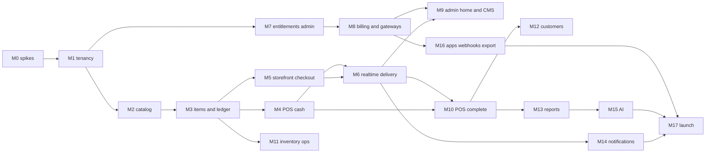

# 09 — Roadmap

Dependency order, not a calendar. A sprint is two weeks. The team shape is one senior backend, one senior frontend, one full-stack (OQ-12). If the team is smaller, keep the order and drop parallelism.

The early slice is M0 through M6: create a tenant, add products from the global catalog, bill a cash sale, place an online order, and move it to delivered with realtime updates.

Spikes happen in M0 before the modules they de-risk. A spike ends in a short note in the PR (what was tried, what the plan should keep). Spikes do not ship UI.

## 1. Sequence

## 2. Spikes (inside M0)

| ID | Question | Timebox | Done when |
| --- | --- | --- | --- |
| S1 | Catalog import and lookup | 4 days | 50-row fixture runs through stage → dry-run → commit on Postgres. GTIN check digit and one fuzzy candidate work. Typesense indexes a published product and a Laravel search returns it filtered by status. Decision: chunk size 500 stays unless the spike shows memory pressure |
| S2 | Offline POS sync | 3 days | A browser stores one cash sale in IndexedDB, replays `POST /sales` with a client uuid, second replay returns the same sale, stock is one decrement. Document the conflict rule again if the spike wants something fancier: it does not get it |
| S3 | Realtime order status | 3 days | Reverb delivers `order.status.changed` to two clients. Killing the socket and calling the stream endpoint with `after` returns the missed event. Poll fallback works with Reverb stopped |
| S4 | Entitlement enforcement | 2 days | Middleware returns 403 for a boolean feature and 422 for a numeric limit. Redis flush on write. A route with the UI "hidden" still 403s |
| S5 | Tenant isolation | 3 days | RLS policy on a sample table. `app_user` cannot read across tenants with the global scope removed. Deptrac skeleton fails on a deliberate illegal import. Host-only cookie approach proved with two local subdomains |

If a spike falsifies an ADR, update [01-architecture.md](./01-architecture.md) before M1 feature work.

## 3. Milestones

### M0 — Foundations (1 sprint)

**Deliverables.** Monorepo skeleton in the existing `backend/` and `frontend/` folders. Compose for Postgres, Redis, Typesense, Mailpit. Caddy wildcard. CI jobs from [07-devops-and-observability.md](./07-devops-and-observability.md) even if tests are thin. Module folders, Deptrac, Pint, Larastan, Scramble empty spec, `@selfx/ui` tokens and one Button. Health endpoints. Spike notes S1–S5.

**Acceptance.** `GET /health/ready` is green locally. A sample RLS test is red when the policy is dropped. Design tokens render in Storybook.

**Demo.** None for a retailer. Show the two subdomains hitting one API.

### M1 — Identity and tenancy (1 sprint)

**Deliverables.** Platform and staff login, TOTP for platform, forced password change, tenant create, reserved slugs, provision chain through storefront shell and welcome email, roles seeded, suspend/restore, `EntitlementGate` with seeded plans (collection still manual).

**Acceptance.** Module acceptance for Identity and Tenancy in [04-module-breakdown.md](./04-module-breakdown.md). Idempotent provision test.

**Demo.** Create "a kirana" in admin, open its subdomain, set a password, see an empty console.

### M2 — Global catalog (2 sprints)

**Deliverables.** Schema `catalog`, roles, product model, identifiers, categories, brands, tax classes, import wizard (CSV/XLSX/JSON), image match by barcode, dry-run, commit, duplicates, review, publish, rollback, versions, submissions inbox, Typesense `catalog_products`, quality page, source screen with every open connector registered and disabled. File import works. A remote source runs only after a licence note is saved.

**Acceptance.** Catalog acceptance in 04. Tenant token cannot publish.

**Demo.** Import a spreadsheet, fix a row error, publish, search by a mistyped name.

### M3 — Store items and ledger (1 sprint)

**Deliverables.** `store_items` link, prices, barcodes, bulk add with margin rules, manual item, CSV import, stock ledger, balance cache, POS lookup by barcode against master and store codes.

**Acceptance.** Inventory M3 acceptance in 04.

**Demo.** From the console, multi-select masters, apply percent-below-MRP, see store prices and zero stock.

### M4 — POS cash vertical (2 sprints)

**Deliverables.** Shift open/close, cash in/out, denominations, X and Z, cash sale, wedge lookup, hold/recall, invoice series, basic GST (inclusive/exclusive, CGST/SGST/IGST), default 80 mm receipt template, print-agent test print, browser-dialog fallback, quick customer create, cashier PIN, counter, low-stock warning from the balance. Dashboard shows today's sales from a simple query, then the aggregate job if it fits the sprint. First task: the agent lists OS printers and prints one ESC/POS test page.

**Acceptance.** Pos M4 acceptance. Concurrency test on invoice numbers. Receipt plan ends with the configured cut. Test print creates no sale.

**Demo.** Open shift, scan, cash tender, change, printed receipt on a connected printer (browser dialog if no agent), stock down by the qty sold. This is the first retailer demo.

### M5 — Storefront and checkout (2 sprints)

**Deliverables.** ISR home, category, product, search with typo tolerance, cart, checkout, pin-code zone, pickup, COD and pay-at-store, and the prepaid drivers (Razorpay, Cashfree, PhonePe, Paytm) in test mode behind the adapter. Customer OTP. Order `placed`. Storefront editor. Language switch and theme toggle on the storefront. Org host lists that organization's stores; choosing one opens the store host. Shell strings for storefront and POS in `en`, `te`, and `hi`.

**Acceptance.** Storefront and checkout acceptance. Webhook replay test for each prepaid driver with a recorded signature fixture. A driver with no keys is hidden, not an error at pay time.

**Demo.** Phone on the same LAN opens the shop, checks out COD, order appears in the console list (refresh allowed; realtime is M6).

### M6 — Realtime and delivery (1 sprint)

**Deliverables.** Full status machine, permissions, timeline, Reverb channels, stream fallback, sound on new order (WebAudio beep, no audio file), delivery OTP, proof upload, reservation release job, pick list, POS orders panel read-only accept/pack if the buttons fit.

**Acceptance.** Orders and Delivery acceptance. Playwright status path can land here or in M17's hardening if the nightly job starts at M6.

**Demo.** The early slice, end to end, including the customer timeline moving without a refresh. **This is the slice the brief asked to see early.**

### M7 — Entitlement admin (1 sprint)

**Deliverables.** Plan CRUD, prices, feature matrix, overrides, usage endpoint, console limit warnings, nav gating, `limit.orders_per_month` and `limit.products` live.

**Acceptance.** Plans acceptance. 403 test with the UI bypassed.

**Demo.** Starter tenant blocked from a second store. Override raised live without a redeploy.

### M8 — Billing and all gateways (2 sprints)

**Deliverables.** Subscription state machine, proration, legal-entity settings, SaaS invoice template with preview, GST PDF (specimen watermark until GSTIN is saved; do not invent a GSTIN), credit notes, coupons, dunning, manual UTR, the same four prepaid adapters used for platform billing, reconciliation CSV, tenant gateway screen, ledger.

**Acceptance.** Billing and Payments acceptance.

**Demo.** Upgrade a tenant mid-cycle, pay with the test gateway, download the invoice PDF.

### M9 — Super admin home, audit, CMS, marketing (1–2 sprints)

**Deliverables.** Aggregate metrics, analytics home with the chart types, drill-down, export, audit search, failed jobs, health page, CMS, marketing site wired to CMS and live plans, impersonation banner and deny-list, leads form, template studio for documents, messages, and reports with preview, admin strings in `en`, `te`, and `hi`, theme toggle on admin and console.

**Acceptance.** Cms, Reporting platform, Audit screens. Template preview writes no invoice and no print job.

**Demo.** Edit the hero in CMS, publish, reload the marketing site. Open a receipt template, change the footer, preview it. Impersonate a tenant and show the banner.

### M10 — POS completeness (2 sprints)

**Deliverables.** Split tenders, UPI/card/wallet/store credit/khata/payment link, returns, exchanges, voids, price override, discounts and promos, loyalty redeem if M12 has not landed then hide behind the entitlement and finish the hook, batches on the line, serial capture, camera scan, offline cash outbox and number blocks, attendance punches, quick keys, orders billed from POS (creates `sales.order_id`). Printer setup: discovery, counter assignment, layout editor (cut, spacing, text style), drawer kick on cash, labels, optional Epson and Star drivers behind the agent.

**Acceptance.** Remaining Pos acceptance, including the offline test from S2 promoted to CI. A tenant override cannot remove the GSTIN block.

**Demo.** Airplane-mode cash sale on a laptop, reconnect, one invoice, one stock decrement. Then a return. Then a test print after changing the cut from full to partial.

### M11 — Inventory operations (2 sprints)

**Deliverables.** Adjustments and wastage, transfers, counts, reorder rules, suppliers, PO, goods receipt, purchase return, supplier ledger, expiry alerts, serial status.

**Acceptance.** Inventory M11 acceptance.

**Demo.** PO → receive with expiry → transfer to a second store → count correction.

### M12 — Customers (1 sprint)

**Deliverables.** Profiles, addresses, history, segments, loyalty ledger and tiers, khata, feedback, import/export, storefront favourites and loyalty panel.

**Acceptance.** Customers acceptance.

**Demo.** Khata sale and a later collection. Loyalty points on a completed sale.

### M13 — Reports (1 sprint)

**Deliverables.** Sales, P&L from `unit_cost_paise`, GST summary, stock valuation, best/slow, staff/shift, customer, payments. Filters, CSV/XLSX/PDF, schedules, Tally-shaped CSV. Each PDF uses the report template from the studio. Switch dashboard fully onto `daily_store_metrics`.

**Acceptance.** Reporting acceptance and the 100k item search check if staging is up.

**Demo.** GST report for a date range and a scheduled email in the sink mailbox.

### M14 — Notifications (1 sprint)

**Deliverables.** SMS provider MSG91, SES email, DLT fields, template studio for messages and reports with preview and publish, push, delivery logs, retries, fallback, quotas, receipt send by SMS and email. WhatsApp driver sends only when the template is approved. Missing credentials show "not configured" and do not fail the order.

**Acceptance.** Notifications acceptance.

**Demo.** Order placed pushes the console and sends the template SMS to a test number.

### M15 — AI (1–2 sprints)

**Deliverables.** Gateway, three providers behind one interface (one live provider is enough if keys exist; the others have contract fakes), quotas, kill switch, tool-calling reports, saved reports, product draft, storefront assistant.

**Acceptance.** Ai acceptance, including the SQL refusal fixture and the cross-store assistant test.

**Demo.** "What sold yesterday?" returns a number, a citation, and no SQL. A product photo becomes a draft the clerk must save.

### M16 — Apps, open API, webhooks, export (1 sprint)

**Deliverables.** App release upload, scan hook, signed URL, entitlement, API keys, `/api/v1/open` reads, outbound webhooks with signing, tenant data export. Organization settings polished: multi-store roles, org dashboard filters.

**Acceptance.** Apps acceptance. SSRF test rejects a private webhook URL. Export contains no other tenant's rows.

**Demo.** Create an API key, `curl` items, rotate the key, show the old key fail.

### M17 — Launch hardening (1 sprint)

**Deliverables.** Larastan to level 8, restore drill notes, CSP enforce, WAF, alert thresholds, runbook pages filled from the outlines, Playwright nightly green, performance checks in [08-testing-and-quality.md](./08-testing-and-quality.md), partition job observed, backup restore onto a scratch instance.

**Acceptance.** Definition of done for the slice tests. No open severity-1 bug. Production SaaS invoices stay watermarked until the legal entity is saved. SMS stays "not configured" until MSG91 keys are saved. Neither is a code change.

**Demo.** The M6 script again on staging, plus a prepaid payment and a GST receipt.

## 4. What is deliberately late

| Item | Why it is not before M6 |
| --- | --- |
| Live gateway keys | The drivers ship in M5. A tenant turns one on when they have credentials |
| Full template studio | M4 prints from the default receipt. Editing every template is M9 |
| Printer layout editor | M4 proves a connected printer. Cut, spacing, and styles are M10 |
| AI | No retailer is blocked from selling |
| Apps manager | There is no binary yet, except the print agent which M4 needs |
| Full CRM and reports | Cash sale and online order matter more |
| Marketing site | Can be a single static page until M9; tenant creation does not need it |
| E-invoice, PostGIS, custom domains, native apps | Phase 2 |

## 5. Phase 2 backlog (not scheduled)

E-invoice IRP, radius delivery with PostGIS, custom domains and TLS, full offline conflict handling, HID scales, further printer vendor SDKs beyond ESC/POS and the OS spooler, a second WhatsApp BSP if MSG91 is replaced, Zoho/QuickBooks APIs, partner delivery driver, split carts across org stores, per-store add-on pricing, native clients against the existing API, dedicated database for a large tenant via `db_target`.

## 6. Demo points (checklist)

| After | Show |
| --- | --- |
| M1 | Tenant exists on its subdomain |
| M2 | Catalog publish and typo search |
| M4 | Cash bill, stock, and a printed receipt |
| M6 | Online order tracked live |
| M8 | Subscription invoice |
| M10 | Offline cash replay, a return, and a changed receipt layout |
| M15 | Cited AI answer |
| M17 | Staging dress rehearsal |
